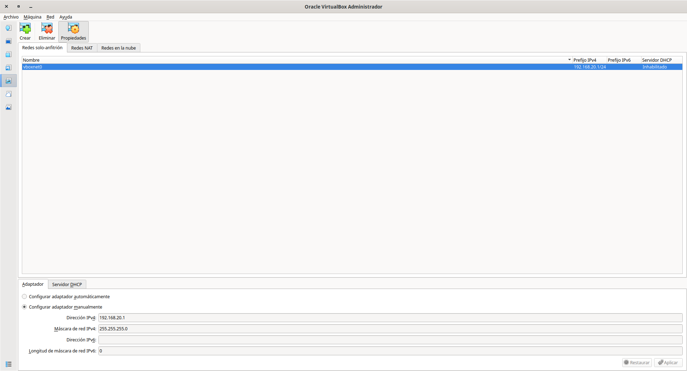
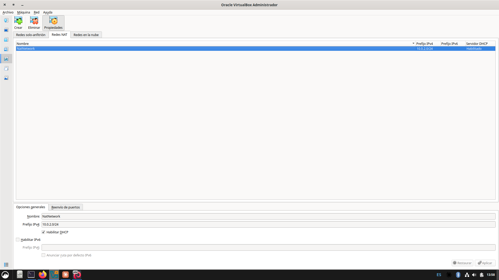
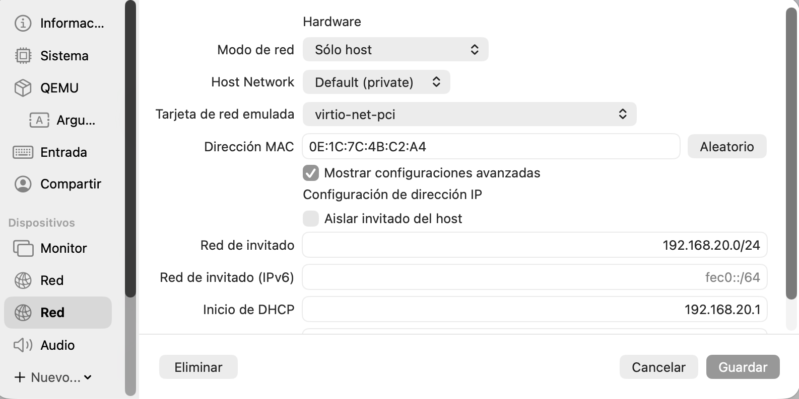
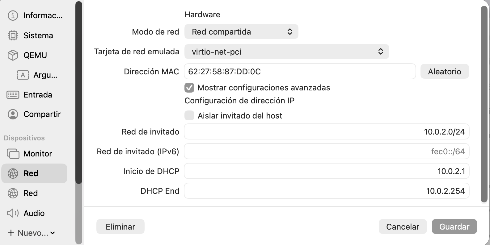
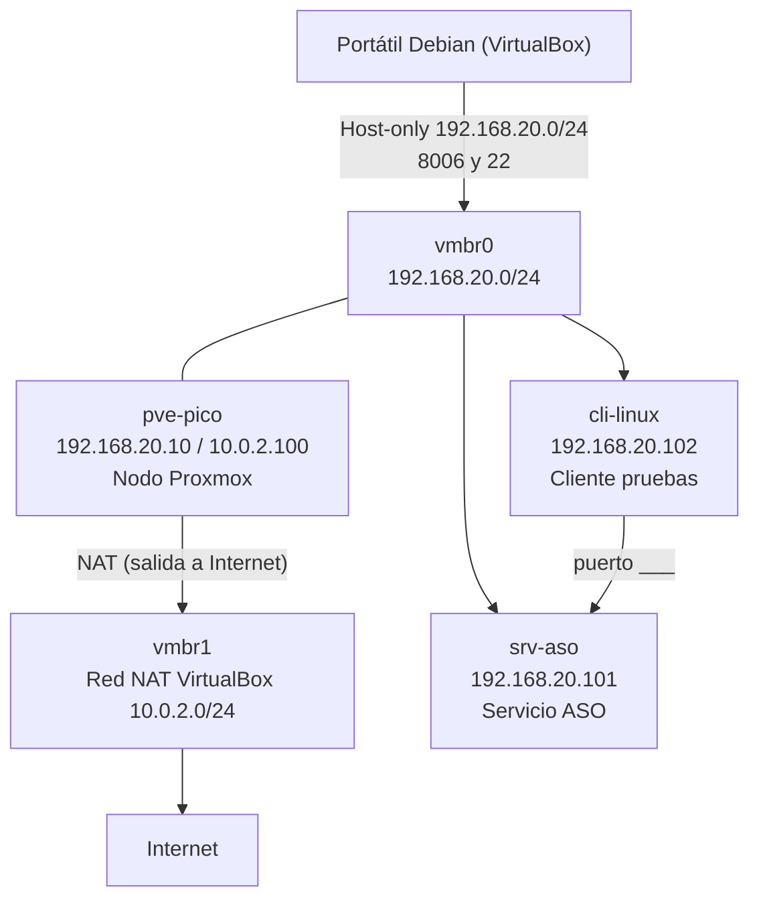
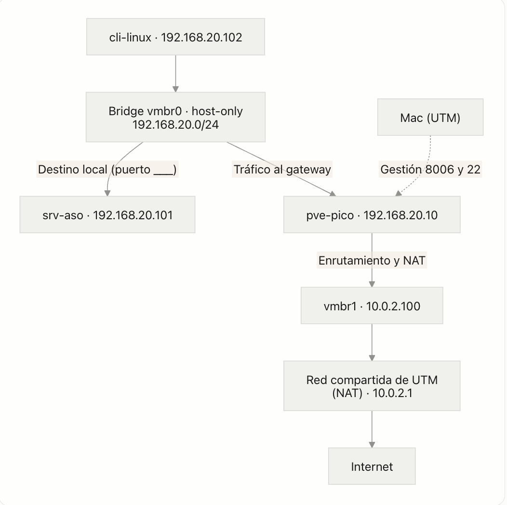

# 02-diagrama-red

## Objetivo
En esta fase del proyecto voy a decidir qué redes va a usar la VM de Proxmox, en mi caso uso VirtualBox en Debian para virtualizarla (antes UTM en el Mac), debo de decidir qué redes configuro y qué IP tiene la máquina. La idea es poder gestionar Proxmox desde mi portátil y que Proxmox y las máquinas invitadas tengan salida a la red.

## Procedimiento
Para este laboratorio necesito que Proxmox esté conectado a dos redes, la primera es la red 'host only'. Host only la he configurado con la red 192.168.20.0/24, esta red la usaré para conectarme a Proxmox vía HTTPS por el puerto TCP:8006. La segunda es una red NAT. En VirtualBox uso la 'Red NAT' (`NatNetwork`) con la red 10.0.2.0/24 y no el 'NAT' normal, porque con el normal Proxmox no conseguía salir por el bridge (lo cuento en la [instalación](03-instalacion-proxmox.md#fases-3-y-4-debian-virtualbox)). En UTM a esta red la llamaban 'red compartida'.

### Configuración de la VM
En estas capturas muestro el estado de la configuración de las interfaces de la VM.

Antes, en UTM:

### Interfaces y bridges de Proxmox

| Interfaz / bridge | Red | IP del nodo | Para qué la uso |
|---|---|---|---|
| `nic0` (host-only `vboxnet0`) → `vmbr0` | Host-only 192.168.20.0/24 | 192.168.20.10 | Esta interfaz me permite conectarme a la interfaz web de Proxmox desde mi portátil vía HTTPS por el puerto TCP:8006. En este bridge también van `srv-aso` y `cli-linux` |
| `nic1` (Red NAT `NatNetwork`) → `vmbr1` | Red NAT 10.0.2.0/24 | 10.0.2.100 | Esta interfaz da salida a Internet a Proxmox. Las VMs salen a Internet a través de Proxmox, que hace NAT hacia esta red |

Las máquinas invitadas van en la red host-only (`vmbr0`) porque así desde mi portátil puedo llegar a ellas directamente para probar y administrar.

### Tabla de direccionamiento

| Elemento | Nombre | IP | Función | Recursos |
|---|---|---|---|---|
| Nodo Proxmox | `pve-pico` | 192.168.20.10 (gestión) / 10.0.2.100 | Hipervisor | 3 vCPU, 4 GB RAM, 70 GB disco fijo (VM de VirtualBox) |
| Servidor ASO | `srv-aso` | 192.168.20.101 | Servicio principal (___), VM | 1 vCPU, 1 GB, 10 GB |
| Cliente | `cli-linux` | 192.168.20.102 | Pruebas, LXC | 1 vCPU, 512 MB, 8 GB |

### Gateway y DNS

| Red / equipo | Gateway | DNS | Comentario |
|---|---|---|---|
| `pve-pico` en host-only 192.168.20.0/24 | Sin gateway | No aplica | Solo se usa para gestionar Proxmox desde el portátil |
| `pve-pico` en Red NAT 10.0.2.0/24 | 10.0.2.1 | 10.0.2.1, 1.1.1.1 | 10.0.2.1 es el router de la Red NAT de VirtualBox, que pasa las consultas al DNS del portátil |
| `srv-aso` y `cli-linux` (192.168.20.0/24) | 192.168.20.10 | 10.0.2.1, 1.1.1.1 | Salen a Internet a través de Proxmox, que hace NAT hacia la red compartida |

### Puertos necesarios

| Origen | Destino | Puerto | Para qué |
|---|---|---|---|
| Portátil (Debian) | `pve-pico` (192.168.20.10) | 8006/TCP | Web de Proxmox |
| Portátil (Debian) | `pve-pico` (192.168.20.10) | 22/TCP | SSH al nodo |
| `cli-linux` | `srv-aso` | ___ | Servicio ASO |
| Invitados | Internet (a través de Proxmox) | 80, 443/TCP y 53/UDP | Actualizaciones y DNS |

## Diagrama de Red

He hecho también un esquema como el que está hecho en el apartado de redes virtuales y recorridos:

## Comandos usados

En este apartado no he usado ningún comando, realizaré las configuraciones en el siguiente paso.

## Evidencias

- [Red host-only en VirtualBox](../evidencias/virtualbox/vbox_red_hostonly.png): `vboxnet0` con 192.168.20.1/24 y sin DHCP.
- [Red NAT en VirtualBox](../evidencias/virtualbox/vbox_red_nat.png): `NatNetwork` con 10.0.2.0/24.
- [Red host-only en UTM](../evidencias/capturas-o-salidas/red_hostonly_utm.png): adaptador host-only de la VM, con la red 192.168.20.0/24.
- [Red compartida en UTM](../evidencias/capturas-o-salidas/red_compartida_utm.png): adaptador de red compartida de la VM, con la red NAT 10.0.2.0/24.

## Incidencias

## Conclusion
Este apartado me permite seguir con los siguientes pasos, este paso es esencial para tener claro más adelante cómo voy a realizar las configuraciones de los adaptadores durante la instalación y después de la instalación. De momento he configurado dos adaptadores, uno con host only que nos sirve para gestionar y otro que hace NAT para la salida de las VMs a Internet.

[Volver al indice](../README.md)