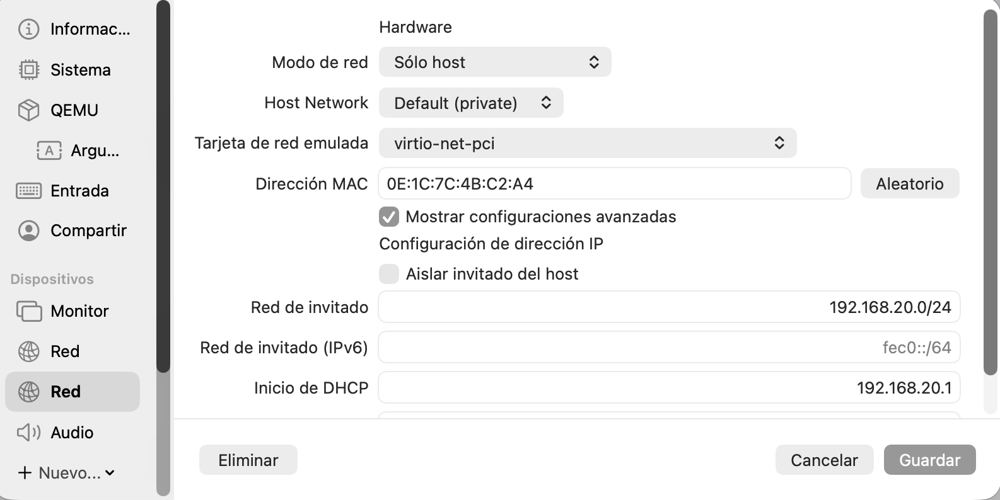
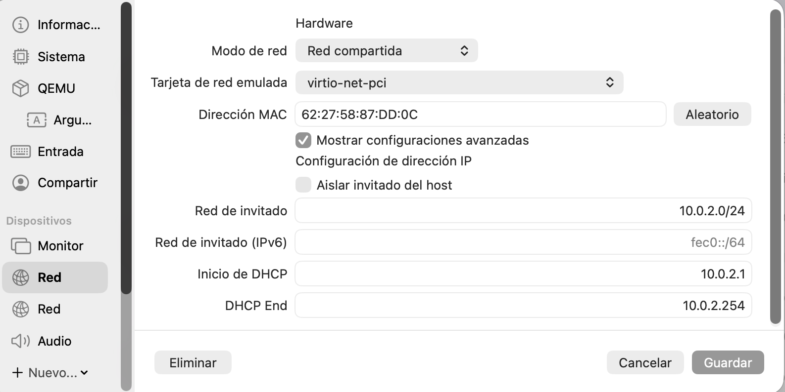
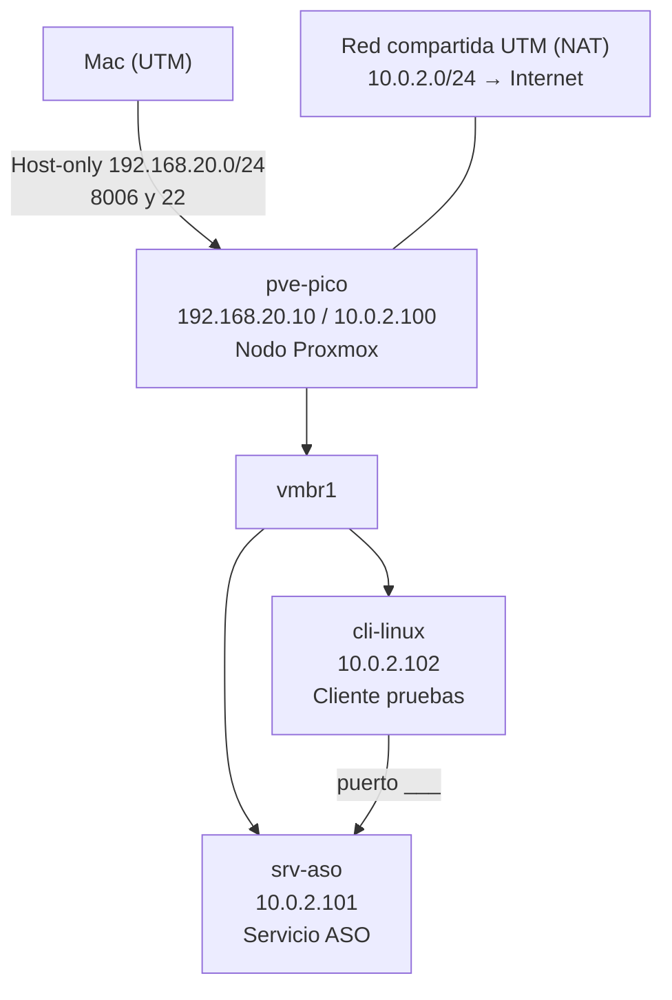

# 02-diagrama-red

## Objetivo
En esta fase del proyecto voy a decidir qué redes va a usar la VM de Proxmox, en mi caso uso UTM para virtualizarla, debo de decidir qué redes configuro y qué IP tiene la máquina. La idea es poder gestionar Proxmox desde mi Mac y que Proxmox y las máquinas invitadas tengan salida a la red.

## Procedimiento
Para este laboratorio necesitamos que nuestro Proxmox esté conectado a dos redes, la primera es la red 'host only'. Host only la hemos configurado con la red 192.168.20.0/24, esta red la usaremos para conectarnos a Proxmox vía HTTPS por el puerto TCP:8006. La segunda es red NAT o en mi caso (uso UTM en vez de VirtualBox) 'red compartida'. Que en UTM se llame red compartida no implica que sea adaptador puente, hace una red NAT la cual he configurado para que sea 10.0.2.0/24.

### Configuración de la VM
En estas capturas muestro el estado de la configuración de las interfaces de la VM.

### Interfaces y bridges de Proxmox

| Interfaz / bridge | Red | IP del nodo | Para qué la uso |
|---|---|---|---|
| Interfaz 1 (host-only) → `vmbr0` | Host-only 192.168.20.0/24 | 192.168.20.10 | Esta interfaz nos permite conectarnos a la interfaz web de Proxmox desde nuestro equipo vía HTTPS por el puerto TCP:8006 |
| Interfaz 2 (red compartida) → `vmbr1` | Red compartida (NAT) 10.0.2.0/24 | 10.0.2.100 | Esta interfaz permite a Proxmox y a las VMs salida a Internet |

### Tabla de direccionamiento

| Elemento | Nombre | IP | Función | Recursos |
|---|---|---|---|---|
| Nodo Proxmox | `pve-pico` | 192.168.20.10 (gestión) / 10.0.2.100 | Hipervisor | 2 vCPU, 6 GB RAM, 70 GB disco (VM de UTM) |
| Servidor ASO | `srv-aso` | 10.0.2.101 | Servicio principal (___) | 1 vCPU, 1 GB, 10 GB |
| Cliente | `cli-linux` | 10.0.2.102 | Pruebas | 1 vCPU, 1 GB, 10 GB |

### Gateway y DNS

| Red | Gateway | DNS | Comentario |
|---|---|---|---|
| Host-only 192.168.20.0/24 | Sin gateway | No aplica | Solo se usa para gestionar Proxmox desde el Mac |
| Red compartida 10.0.2.0/24 | 10.0.2.1 | 10.0.2.1, 1.1.1.1 | 10.0.2.1 es el Mac, que reenvía las consultas al DNS de la red en la que esté |

### Puertos necesarios

| Origen | Destino | Puerto | Para qué |
|---|---|---|---|
| Mac | `pve-pico` (192.168.20.10) | 8006/TCP | Web de Proxmox |
| Mac | `pve-pico` (192.168.20.10) | 22/TCP | SSH al nodo |
| `cli-linux` | `srv-aso` | ___ | Servicio ASO |
| Invitados | Internet | 80, 443/TCP y 53/UDP | Actualizaciones y DNS |

## Diagrama de Red

## Comandos usados

En este apartado no he usado ningún comando, realizaremos las configuraciones en el siguiente paso.

## Evidencias

- [Red host-only en UTM](../evidencias/capturas-o-salidas/red_hostonly_utm.png): 
- [Red compartida en UTM](../evidencias/capturas-o-salidas/red_compartida_utm.png): 

## Incidencias

## Conclusion
Este apartado nos permite seguir con los siguientes pasos, este paso es esencial para tener claro más adelante cómo vamos a realizar las configuraciones de los adaptadores durante la instalación y después de la instalación.

[Volver al indice](../README.md)