# 03-instalacion-proxmox

Este documento tiene tres partes: [Fase 3 (macOS, UTM)](#fase-3-macos-utm), [Fase 4 (macOS, UTM)](#fase-4-macos-utm-configuración-base-del-nodo) y [Fases 3 y 4 (Debian, VirtualBox)](#fases-3-y-4-debian-virtualbox).

# Fase 3 (macOS, UTM)

## Objetivo
En esta fase instalo Proxmox VE 9.2 para ARM64 en una VM de UTM, siguiendo el diseño de red del [02](02-diagrama-red.md). Al terminar quiero poder entrar al panel web desde el navegador de mi Mac.

## Procedimiento

### 1. Equipo anfitrión y UTM
Uso un MacBook Air con chip M4, 16 GB de RAM y macOS 27.0.1. Para virtualizar uso UTM versión 4.7.5, con el motor QEMU. No uso VirtualBox porque en Mac con chip Apple funciona peor que UTM.


### 2. Creación de la VM
He creado una VM Linux ARM64 con los recursos del diseño:

| Recurso | Valor |
|---|---|
| Motor | QEMU (virtualización) |
| CPU | 2 vCPU |
| RAM | 6 GB |
| Disco | 70 GB |
| Rosetta | Desactivado |

Al Mac le quedan 10 GB de RAM para macOS, así no se queda sin memoria mientras la VM está encendida.


### 3. Red de la VM
La VM tiene dos tarjetas de red, como en el diseño:

- Tarjeta 1: red host-only 192.168.20.0/24. Es la red de gestión y la de las máquinas invitadas.
- Tarjeta 2: red compartida (NAT de UTM) 10.0.2.0/24. Es la salida a Internet.


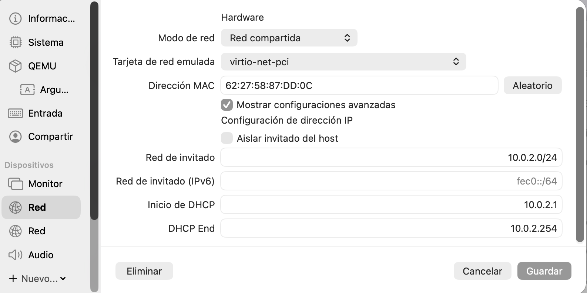

### 4. Virtualización anidada
Con el motor QEMU de UTM en un Mac con chip Apple no hay virtualización anidada. Lo he comprobado después de instalar: `ls -l /dev/kvm` dice que no existe y en `dmesg` sale `kvm [1]: HYP mode not available`, es decir, la VM no tiene el modo hipervisor de la CPU. Al intentar arrancar una VM de prueba en Proxmox da error de KVM.

Por eso `srv-aso` y `cli-linux` serán contenedores LXC, que no necesitan KVM. Las VMs sin KVM irían emuladas y muy lentas.


### 5. Instalación de Proxmox
He usado la ISO de Proxmox VE 9.2 para ARM64 (`proxmox-ve_9.2-1-arm64.iso`), descargada de la página oficial de Proxmox.

En el instalador he elegido:
- Disco: el disco de 70 GB de la VM (`/dev/vda`).
- Sistema de archivos: ext4 (LVM), porque ZFS gasta más RAM y solo tengo 6 GB en la VM.
- País, zona horaria y teclado: España, Europe/Madrid, español.


### 6. Hostname, IP, gateway y DNS
En la pantalla de red del instalador he elegido la tarjeta de la red host-only como interfaz de gestión:

| Dato | Valor |
|---|---|
| Hostname | brunop.local |
| Interfaz de gestión | nic1 (tarjeta host-only) |
| IP de gestión | 192.168.20.3/24 |
| Gateway (en el instalador) | 192.168.20.1 |
| DNS | 10.0.2.1 |

El instalador obliga a poner un gateway, pero la red host-only no tiene salida a Internet. Puse 192.168.20.1 (el Mac en la red host-only) solo para poder seguir. El gateway real, por la red compartida, lo configuraré en la fase de red.

> En la fase 4 cambié el hostname a `pve-pico`, la IP a 192.168.20.10 y puse el gateway real (10.0.2.1). Está en la [fase 4](#fase-4-macos-utm-configuración-base-del-nodo).


### 7. Acceso al panel web
Desde el navegador del Mac entro a `https://192.168.20.3:8006`. Sale un aviso de certificado porque es autofirmado, lo acepto y entro con el usuario `root` (Linux PAM).


### 8. Red y almacenamiento después de instalar
`pveversion` muestra `pve-manager/9.2.9` con el kernel `7.0.14-6-pve`, y `hostnamectl` confirma que es Debian 13 (trixie) en arm64 dentro de QEMU.

El instalador crea el bridge `vmbr0` con la tarjeta host-only y la IP 192.168.20.3. La otra tarjeta (`nic0`, red compartida) queda sin configurar. El resto de la red (bridges del diseño y NAT) lo configuro en la fase siguiente.


Con ext4 el instalador crea dos almacenamientos. La raíz (`/dev/mapper/pve-root`) tiene 28 GB con 3,7 GB usados y el resto del disco queda para `local-lvm`:
- `local`: guarda ISOs, plantillas de contenedores y copias de seguridad.
- `local-lvm`: guarda los discos de las VMs y de los contenedores.

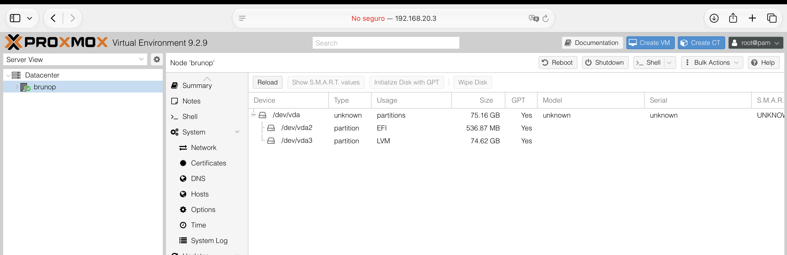


### 9. srv-aso y cli-linux
Las dos máquinas irán dentro de Proxmox, no como VMs de UTM. Como no hay virtualización anidada, serán contenedores LXC sin privilegios. Los crearé en la fase 5.

## Comandos usados

```bash
# Evidencias que pide el enunciado
hostnamectl
ip -br addr
pveversion
df -h

# Virtualización anidada
ls -l /dev/kvm
dmesg | grep -i -E "kvm|hyp|EL2"
```

## Evidencias

- [Panel de Proxmox](../evidencias/capturas-o-salidas/proxmox_navegador.png): entro al panel desde el navegador del Mac.
- [Red en Proxmox](../evidencias/capturas-o-salidas/red_proxmox.png): `vmbr0` creado por el instalador con la IP 192.168.20.3.
- [Almacenamiento en Proxmox](../evidencias/capturas-o-salidas/almacenamiento_proxmox.png): `local` y `local-lvm`.
- [hostnamectl](../evidencias/capturas-o-salidas/hostnamectl.txt): nombre del nodo (brunop), Debian 13, arm64 y virtualización QEMU.
- [ip -br addr](../evidencias/capturas-o-salidas/ipbr-pve.txt): `vmbr0` con la IP 192.168.20.3, `nic1` UP y `nic0` DOWN.
- [pveversion](../evidencias/capturas-o-salidas/pveversion.txt): pve-manager 9.2.9 con kernel 7.0.14-6-pve.
- [df -h](../evidencias/capturas-o-salidas/df-pve.txt): raíz de 28 GB con 3,7 GB usados.
- [Virtualización anidada](../evidencias/capturas-o-salidas/kvm.txt): no hay `/dev/kvm` y `HYP mode not available`.
- Capturas de UTM e instalador: en los apartados 1, 2, 3, 5 y 6.

## Incidencias

- En el instalador puse el hostname `brunop.local` en lugar de `pve-pico`, que es el nombre del diseño. Más adelante lo cambiaré por `pve-pico`.
- Probé el motor Apple Virtualization de UTM para tener virtualización anidada, pero no tiene red host-only y el diseño necesita dos tarjetas. Me quedé con QEMU y los invitados serán LXC.
- El instalador pide un gateway en la interfaz de gestión y la red host-only no tiene salida a Internet. Puse 192.168.20.1 para poder seguir y el gateway real lo configuraré en la fase de red.

## Conclusion
Proxmox queda instalado en una VM de UTM y accesible desde el Mac en `https://192.168.20.3:8006`. Como no hay virtualización anidada, `srv-aso` y `cli-linux` serán contenedores LXC. En la fase siguiente configuraré la red como en el diseño.

---

# Fase 4 (macOS, UTM): configuración base del nodo

## Objetivo
En esta fase dejo el nodo preparado antes de crear las máquinas. Reviso los almacenamientos, configuro la red como en el [diseño](02-diagrama-red.md), miro qué cuentas pueden administrar el nodo y actualizo el reparto de recursos. También aplico en UTM las mejoras que pidió el profesor.

## Procedimiento

### 1. Mejoras de la VM en UTM
El profesor pidió cinco mejoras que son de VirtualBox. Yo uso UTM en un Mac con chip ARM, así que he buscado lo que equivale a cada una:

| Mejora | En UTM | Estado | Evidencia |
|---|---|---|---|
| Habilitar VT-x | No existe en ARM. Lo parecido es la virtualización anidada, y QEMU no la tiene | No se puede | [kvm.txt](../evidencias/capturas-o-salidas/kvm.txt) |
| Paravirtualización KVM | Casilla "Usar hipervisor" y dispositivos virtio | Hecha | [utm_hipervisor.png](../evidencias/capturas-o-salidas/utm_hipervisor.png), [virtio.txt](../evidencias/capturas-o-salidas/virtio.txt) |
| Modo promiscuo | Proxmox lo activa solo al crear el bridge | Hecha | [promiscuo.txt](../evidencias/capturas-o-salidas/promiscuo.txt) |
| Disco de tamaño fijo | Convertir el disco con `qemu-img` | Hecha | [qemu-img-info.txt](../evidencias/capturas-o-salidas/qemu-img-info.txt) |
| Controlador virtio-scsi | Interfaz SCSI en UTM | No arranca, me quedo con VirtIO | [utm_disco_scsi.png](../evidencias/capturas-o-salidas/utm_disco_scsi.png), [uefi_shell_scsi.png](../evidencias/capturas-o-salidas/uefi_shell_scsi.png), [uefi_map_scsi.png](../evidencias/capturas-o-salidas/uefi_map_scsi.png) |

**VT-x:** VT-x es de los procesadores Intel y mi Mac tiene un M4, que es ARM. Lo que se parece es la virtualización anidada, pero con el motor QEMU de UTM no está: no existe `/dev/kvm` y `dmesg` dice `HYP mode not available`. El motor Apple Virtualization sí la tiene, pero no tiene red host-only y yo necesito dos tarjetas. Por eso los invitados serán contenedores LXC, que no necesitan KVM. Con VirtualBox en el Mac pasaría lo mismo, porque esa opción solo sale en equipos x86.

**Paravirtualización:** en UTM esto es la casilla "Usar hipervisor", que ya estaba marcada. Con ella la VM usa la virtualización del chip en vez de emular. Además el disco y la red son virtio. Con `lsmod` solo salen algunos módulos virtio, porque los del disco (`virtio_blk`) y la red (`virtio_net`) vienen dentro del kernel. Por eso los he sacado también con `ls /sys/bus/virtio/drivers` ([virtio-drivers.txt](../evidencias/capturas-o-salidas/virtio-drivers.txt)).

**Modo promiscuo:** UTM no tiene esta opción, pero no hace falta. Cuando Proxmox mete `nic1` en el bridge `vmbr0`, la pone en modo promiscuo él solo, y así acepta los paquetes que van a los contenedores. Lo he comprobado con `ip -d link show nic1`, que da `promiscuity 1`. En la fase 5 lo probaré de verdad haciendo ping desde el Mac a un contenedor.

**Disco fijo:** UTM crea el disco dinámico, es decir, va creciendo según se usa. Con la VM apagada lo he convertido con `qemu-img` para que ocupe los 70 GB desde el principio. Antes guardé el disco original como `original.qcow2.bak` por si no arrancaba, y cuando vi que iba bien lo borré.

**virtio-scsi:** cambié la interfaz del disco a SCSI pero la VM no arrancaba, se quedaba en la UEFI Shell. Con `map -r` solo salía `BLK0` y no el disco, o sea, el firmware no lo veía. Como había hecho el cambio a disco fijo a la vez, volví a poner VirtIO para ver cuál de los dos fallaba, y con VirtIO arrancó bien. El problema era el SCSI. Se lo comenté al profesor y me dijo que puedo seguir con VirtIO, que también es un controlador virtio.

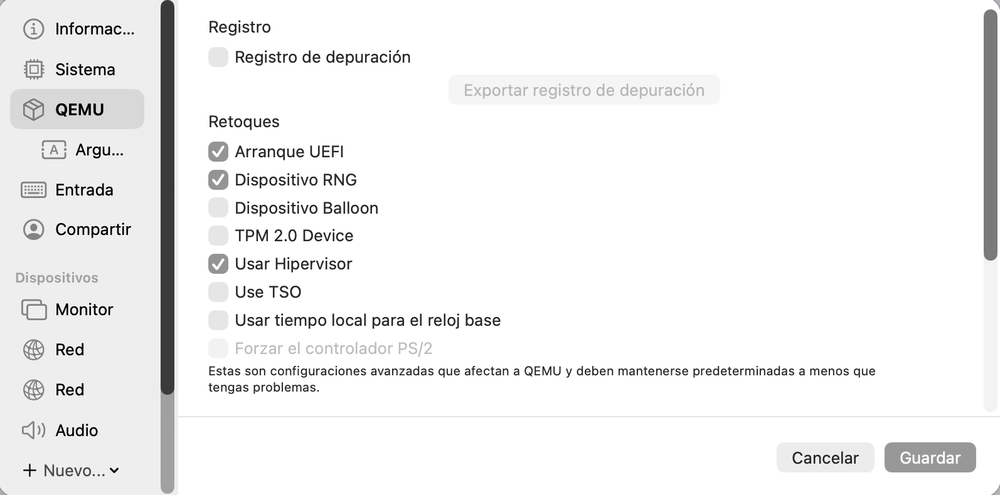
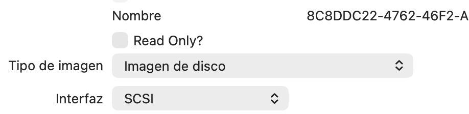
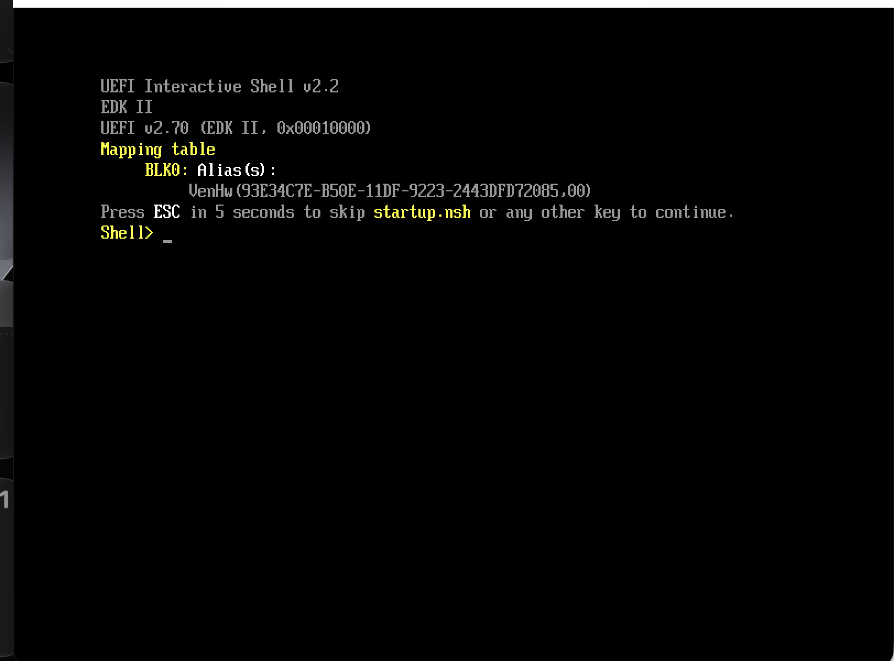
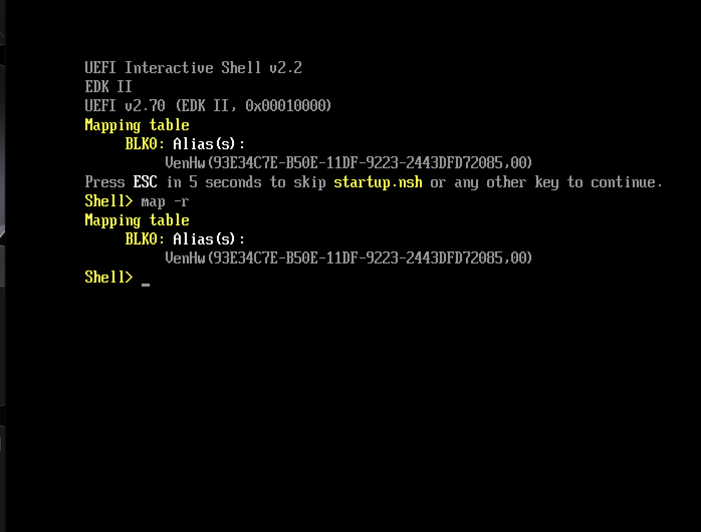
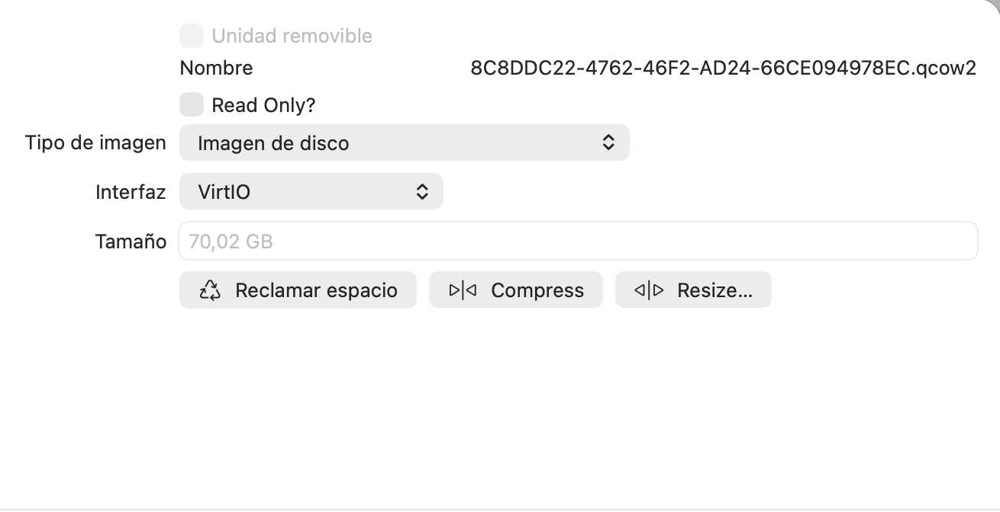

### 2. Almacenamiento
En Datacenter > Storage tengo tres almacenamientos. Los datos los he sacado con `pvesm status`, `df -h`, `lvs` y `vgs` ([almacenamiento-pve.txt](../evidencias/capturas-o-salidas/almacenamiento-pve.txt)):

| Almacenamiento | Tipo | Qué guarda | Total | Libre | Para qué lo uso |
|---|---|---|---|---|---|
| `local` | Directorio (`/var/lib/vz`) | Backup, Import, ISO y plantillas de contenedor | 27,3 GiB | 22,3 GiB | Plantillas LXC e ISOs |
| `local-lvm` | LVM-Thin | Discos de VMs y contenedores | 25,17 GiB | 25,17 GiB | Discos de `srv-aso` y `cli-linux` |
| `backup-lab` | Directorio (`/srv/backup-lab`) | Solo backups | 27,3 GiB (el mismo que `local`) | 22,3 GiB | Copias de la fase 9 |

El disco de 70 GB está repartido así: 27,93 GB para la raíz, 25,17 GB para `local-lvm` y 5,76 GB de swap. Quedan 8,63 GB sin usar.

`local-lvm` solo guarda discos de máquinas, así que las copias no pueden ir ahí. Por eso he creado `backup-lab`, una carpeta en `/srv/backup-lab` que solo admite copias. Está en la raíz igual que `local`, por eso los dos salen con el mismo espacio, y lo que ocupen las copias se lo quita a las ISOs y plantillas.

**Espacio en el Mac:** la VM no está en el disco del Mac, está en un SSD externo Kingston con 517 GiB libres ([mac-df.txt](../evidencias/capturas-o-salidas/mac-df.txt)). Como el disco ya es fijo, la VM no va a crecer más. El problema es que las copias están dentro del mismo disco que el laboratorio: si el Kingston falla o se desconecta con la VM encendida, lo pierdo todo, copias incluidas. En la fase 9 sacaré una copia fuera.

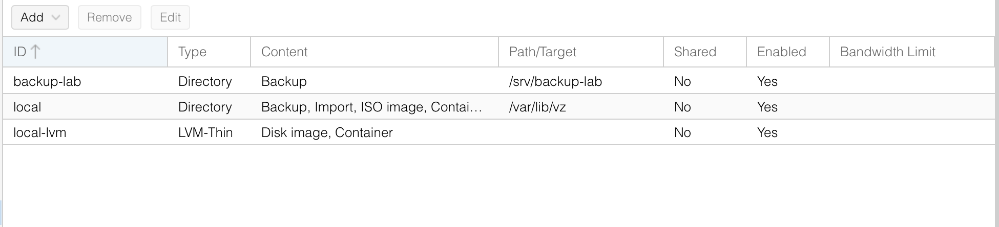
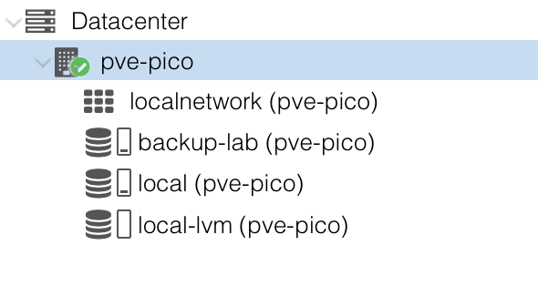

### 3. Red
Antes ([red-antes.txt](../evidencias/capturas-o-salidas/red-antes.txt)) solo estaba `vmbr0` con la IP 192.168.20.3 y el gateway falso 192.168.20.1 del instalador. `nic0` estaba apagada, así que el nodo no tenía Internet.

Ahora queda así ([red-despues.txt](../evidencias/capturas-o-salidas/red-despues.txt)):

| Bridge | Tarjeta | Red de UTM | IP | Gateway | Para qué |
|---|---|---|---|---|---|
| `vmbr0` | `nic1` | Host-only 192.168.20.0/24 | 192.168.20.10/24 | No tiene | Entrar desde el Mac (8006 y 22) y red de `srv-aso` y `cli-linux` |
| `vmbr1` | `nic0` | Red compartida (NAT) 10.0.2.0/24 | 10.0.2.100/24 | 10.0.2.1 | Salida a Internet del nodo y de los invitados |

Lo he hecho desde la consola de UTM, por si al cambiar la IP perdía la conexión del navegador:
1. Copia de `/etc/network/interfaces` en `/root/interfaces.bak`.
2. En `/etc/network/interfaces` cambio `vmbr0` a la .10 sin gateway, creo `vmbr1` con `nic0`, la IP 10.0.2.100 y el gateway 10.0.2.1, y añado el NAT para que los invitados salgan a Internet por `vmbr1` ([interfaces.txt](../evidencias/capturas-o-salidas/interfaces.txt), [captura del editor](../evidencias/capturas-o-salidas/interfaces_nano.png)).
3. En `/etc/hosts` pongo `192.168.20.10 pve-pico.local pve-pico`, porque Proxmox necesita que su nombre apunte a la IP de gestión.
4. Aplico los cambios con `ifreload -a`.

Comprobaciones ([conectividad.txt](../evidencias/capturas-o-salidas/conectividad.txt)):
- El panel abre en `https://192.168.20.10:8006` ([panel_fase4.png](../evidencias/capturas-o-salidas/panel_fase4.png)).
- Los dos bridges están levantados y la ruta por defecto va por `vmbr1` a 10.0.2.1.
- La regla NAT está puesta. Todavía tiene 0 paquetes porque no hay invitados; la probaré en la fase 5.
- El ping al gateway 10.0.2.1 funciona.
- El DNS del nodo es 10.0.2.1, el Mac en la red compartida ([dns.txt](../evidencias/capturas-o-salidas/dns.txt)). En el diseño puse también 1.1.1.1 como segundo DNS, pero con 10.0.2.1 ya resuelve bien, así que lo dejo así.
- `deb.debian.org` se resuelve bien, aunque el ping no responde. No es problema de conexión, porque `apt update` sí descarga. El ping no sale porque la red del instituto bloquea el ping hacia Internet por las políticas del centro.

**Repositorios:** el primer `apt update` daba error 401 en los repositorios enterprise de Proxmox, porque son de pago. En Updates > Repositories los he desactivado y he añadido el No-Subscription, que es gratis y es el que se usa para laboratorios. Ahora `apt update` va sin errores y hay 158 paquetes para actualizar ([apt-update.txt](../evidencias/capturas-o-salidas/apt-update.txt)).

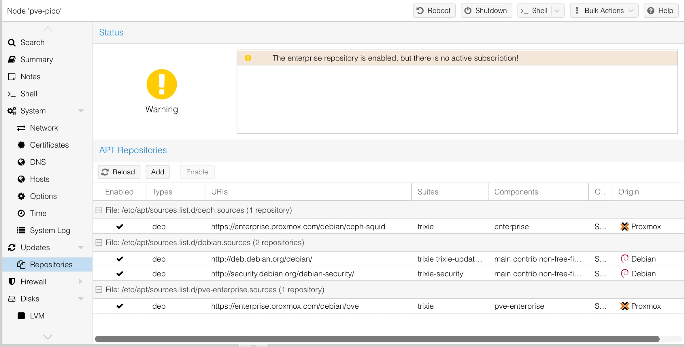
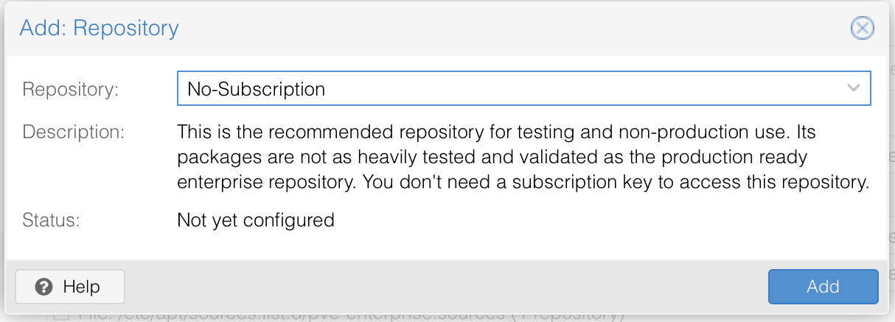
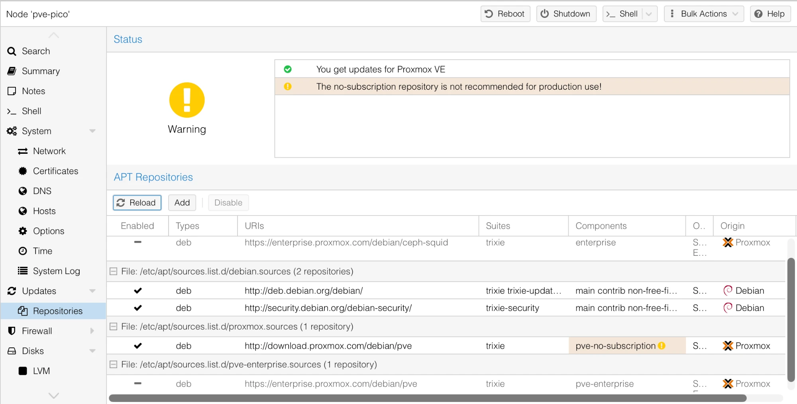

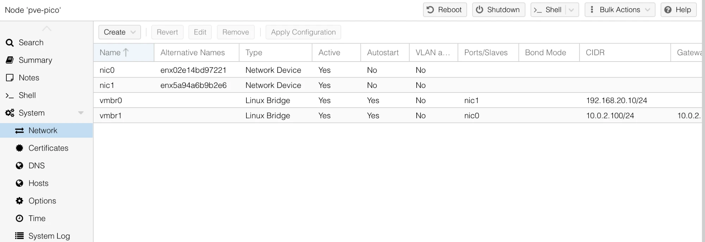

### 4. Accesos administrativos

| Cuenta | Realm | Permisos | Para qué la uso |
|---|---|---|---|
| `root` | Linux PAM | Administrador de todo | Es la única cuenta: la uso en el panel, la consola y por SSH |

Solo uso `root@pam`, que es el administrador del sistema y de Proxmox. Como el laboratorio es solo mío me vale. En un entorno real crearía un usuario con menos permisos, por ejemplo con el rol `PVEVMAdmin`, que puede manejar las máquinas pero no el nodo. Las contraseñas no salen en las capturas ni en el repositorio.

El firewall de Proxmox lo dejo desactivado, como viene, porque no es obligatorio. No hay ninguna regla configurada ([firewall_fase4.png](../evidencias/capturas-o-salidas/firewall_fase4.png)). El laboratorio ya está bastante aislado:
- Al panel y al SSH solo se llega por la red host-only, que solo existe entre mi Mac y la VM.
- Los invitados solo salen a Internet a través del nodo, con NAT.
- La red compartida de UTM también es NAT, así que desde fuera no se puede entrar a la VM.

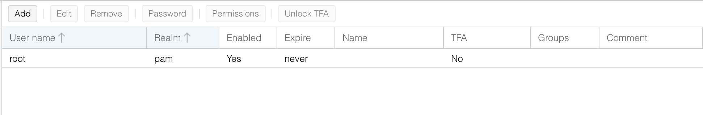
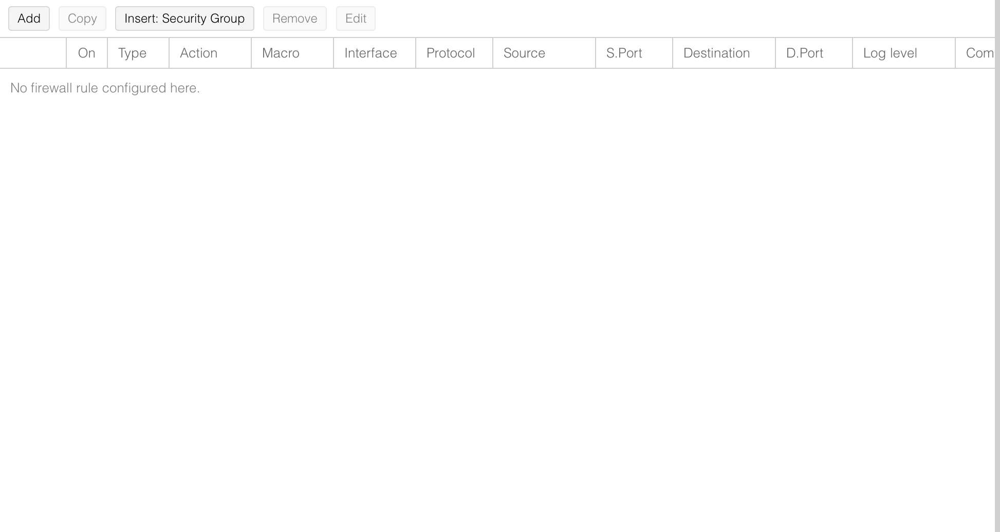

### 5. Reparto de recursos
Actualizo el reparto del [inventario](01-inventario-hardware.md) con lo que tengo después de instalar:

| Elemento | CPU/vCPU | RAM | Disco | Motivo |
|---|---|---|---|---|
| Mac (anfitrión) | 10 núcleos M4, 8 para macOS | 10 GB | SSD externo Kingston (517 GiB libres) | Que macOS vaya bien con la VM encendida |
| VM de Proxmox (UTM) | 2 vCPU | 6 GB | 70 GB fijos | Todo el laboratorio va dentro |
| Nodo Proxmox | Comparte las 2 vCPU | 2 GB | Raíz de 27,93 GB y swap de 5,76 GB | Sistema y panel de Proxmox |
| srv-aso (LXC) | 1 vCPU | 2 GB | 10 GB en `local-lvm` | Servicio principal |
| cli-linux (LXC) | 1 vCPU | 1 GB | 8 GB en `local-lvm` | Solo para probar el servicio |
| Plantillas, ISOs, copias y margen | — | 1 GB de margen | 7 GB en `local-lvm` y 22 GB en la raíz | Clonar y hacer copias sin quedarme sin espacio |

- **RAM:** la VM tiene 6 GB ([free-pve.txt](../evidencias/capturas-o-salidas/free-pve.txt)). 6 − 2 del nodo − 2 de `srv-aso` − 1 de `cli-linux` = 1 GB de margen. Al ser contenedores gastarán menos de lo que les asigno.
- **Disco:** en `local-lvm` quedan 25,17 − 10 − 8 = 7,17 GB para clones. En la raíz hay 22,3 GB libres para plantillas, ISOs y copias.
- **CPU:** las 2 vCPU las comparten el nodo y los dos contenedores. Con poco uso van bien los tres a la vez.

Puedo tener el nodo, `srv-aso` y `cli-linux` encendidos a la vez y seguir entrando al panel. Lo que no conviene es hacer copias o clonar mientras pruebo el servicio.

## Comandos usados

```bash
# Almacenamiento
pvesm status
df -h
lvs
vgs
mkdir -p /srv/backup-lab
pvesm add dir backup-lab --path /srv/backup-lab --content backup

# Memoria
free -h

# Red
ip -br addr
ip route
cp /etc/network/interfaces /root/interfaces.bak
nano /etc/network/interfaces
nano /etc/hosts
ifreload -a
hostname -i
cat /etc/resolv.conf
iptables -t nat -L POSTROUTING -n -v
ping -c3 10.0.2.1
ping -c3 deb.debian.org
apt update

# Mejoras de la VM
lsmod | grep virtio
ls /sys/bus/virtio/drivers
ip -d link show nic1 | grep promiscuity
lsblk

# En el Mac, con la VM apagada
qemu-img convert -p -O qcow2 -o preallocation=full disco.qcow2 fijo.qcow2
qemu-img info disco.qcow2
df -h /Volumes/Kingston
```

## Evidencias

- [almacenamiento-pve.txt](../evidencias/capturas-o-salidas/almacenamiento-pve.txt): `pvesm status`, `df -h` y `lvs` con los almacenamientos y el reparto del disco.
- [storage_fase4.png](../evidencias/capturas-o-salidas/storage_fase4.png): Datacenter > Storage con `local`, `local-lvm` y `backup-lab`.
- [red-antes.txt](../evidencias/capturas-o-salidas/red-antes.txt): red que dejó el instalador (IP .3 y gateway falso).
- [interfaces.txt](../evidencias/capturas-o-salidas/interfaces.txt): `/etc/network/interfaces` final con `vmbr0`, `vmbr1` y NAT.
- [red-despues.txt](../evidencias/capturas-o-salidas/red-despues.txt): `ip -br addr`, `ip route`, `hostname -i` y regla NAT.
- [conectividad.txt](../evidencias/capturas-o-salidas/conectividad.txt): ping al gateway, resolución de nombres y primer `apt update` (error 401 en enterprise).
- [apt-update.txt](../evidencias/capturas-o-salidas/apt-update.txt): `apt update` sin errores con el repositorio *no-subscription*.
- [repositorios_antes.png](../evidencias/capturas-o-salidas/repositorios_antes.png), [repositorio_add.png](../evidencias/capturas-o-salidas/repositorio_add.png) y [repositorios_fase4.png](../evidencias/capturas-o-salidas/repositorios_fase4.png): cambio de repositorios en el panel.
- [panel_fase4.png](../evidencias/capturas-o-salidas/panel_fase4.png): panel accesible en `https://192.168.20.10:8006`.
- [interfaces_nano.png](../evidencias/capturas-o-salidas/interfaces_nano.png): edición de `/etc/network/interfaces`.
- [red_fase4.png](../evidencias/capturas-o-salidas/red_fase4.png): Nodo > System > Network con los dos bridges.
- [usuarios_fase4.png](../evidencias/capturas-o-salidas/usuarios_fase4.png): usuarios y permisos en Proxmox.
- [firewall_fase4.png](../evidencias/capturas-o-salidas/firewall_fase4.png): firewall sin reglas.
- [dns.txt](../evidencias/capturas-o-salidas/dns.txt): DNS del nodo (10.0.2.1).
- [hostnamectl.txt](../evidencias/capturas-o-salidas/hostnamectl.txt): hostname `pve-pico`.
- [utm_hipervisor.png](../evidencias/capturas-o-salidas/utm_hipervisor.png) y [virtio.txt](../evidencias/capturas-o-salidas/virtio.txt): hipervisor activado y módulos virtio.
- [virtio-drivers.txt](../evidencias/capturas-o-salidas/virtio-drivers.txt): drivers virtio del disco y de la red, integrados en el kernel.
- [promiscuo.txt](../evidencias/capturas-o-salidas/promiscuo.txt): `nic1` con `promiscuity 1`.
- [utm_disco_scsi.png](../evidencias/capturas-o-salidas/utm_disco_scsi.png), [uefi_shell_scsi.png](../evidencias/capturas-o-salidas/uefi_shell_scsi.png) y [uefi_map_scsi.png](../evidencias/capturas-o-salidas/uefi_map_scsi.png): prueba con SCSI y fallo de arranque.
- [utm_disco_virtio.png](../evidencias/capturas-o-salidas/utm_disco_virtio.png): configuración final del disco en UTM, interfaz VirtIO y 70,02 GB.
- [qemu_convert.png](../evidencias/capturas-o-salidas/qemu_convert.png): conversión del disco a tamaño fijo.
- [qemu-img-info.txt](../evidencias/capturas-o-salidas/qemu-img-info.txt): disco de tamaño fijo.
- [free-pve.txt](../evidencias/capturas-o-salidas/free-pve.txt): memoria de la VM (6 GB) vista desde el nodo.
- [mac-df.txt](../evidencias/capturas-o-salidas/mac-df.txt): espacio libre en el SSD externo donde está la VM.

## Incidencias

- El instalador dejó un gateway falso (192.168.20.1) y el nodo no tenía Internet. Lo quité y puse el bueno, 10.0.2.1 por `vmbr1`.
- La IP del nodo era la .3 y en el diseño la .10. La cambié a la .10 para que cuadre con el diagrama.
- De las cinco mejoras del profesor he hecho tres. VT-x no existe en un Mac ARM (lo explico en el apartado 1).
- Con el disco en SCSI la VM se quedaba en la UEFI Shell porque no veía el disco. Volví a VirtIO y arrancó bien. El profesor me dijo que puedo seguir con VirtIO.
- `apt update` daba error 401 con los repositorios enterprise porque son de pago. Los desactivé y puse el No-Subscription.
- El ping a `deb.debian.org` no responde, pero `apt update` descarga bien, así que Internet funciona. El ping no pasa porque las políticas del centro lo bloquean en la red del instituto.

## Conclusion
El nodo ya está listo para crear las máquinas. Entro al panel desde el Mac en la .10, el nodo tiene Internet, resuelve nombres y se actualiza. Los tres almacenamientos funcionan y el reparto de recursos deja margen para tener el servidor y el cliente encendidos a la vez.

Para la siguiente fase me queda actualizar los 158 paquetes, descargar una plantilla LXC ARM64 y preparar la plantilla Linux. En la fase 5 también comprobaré que el NAT funciona desde los contenedores.

# Fases 3 y 4 (Debian, VirtualBox)

## Objetivo
El profesor quería que el laboratorio fuera con VirtualBox, así que he vuelto a hacer las fases 3 y 4 en mi portátil con Debian. Así además me quito el problema que tenía en el Mac, que no tenía KVM y los invitados solo podían ser contenedores LXC. Lo que hice con UTM lo dejo arriba para que se vea cómo empecé, y también está guardado en la etiqueta `utm-macos-fase4` del repositorio.

## Procedimiento

### 1. Equipo anfitrión
El portátil tiene Debian 13.7, un Intel i5-10210U de 4 núcleos y 8 hilos con VT-x, 7,6 GiB de RAM y un NVMe de 930 GB. Lo he sacado con los mismos comandos que en la fase 1 ([host-lscpu.txt](../evidencias/virtualbox/host-lscpu.txt), [host-free.txt](../evidencias/virtualbox/host-free.txt), [host-lsblk.txt](../evidencias/virtualbox/host-lsblk.txt)). VirtualBox lo instalé desde el repositorio fasttrack de Debian ([host-vbox.txt](../evidencias/virtualbox/host-vbox.txt)).

Aquí tuve el primer problema: el portátil tiene Secure Boot activado ([host-secureboot.txt](../evidencias/virtualbox/host-secureboot.txt)) y VirtualBox no arrancaba porque sus módulos no están firmados. Para arreglarlo creé una clave MOK con `openssl`, la registré con `mokutil --import` y al reiniciar salió una pantalla azul (MOK Manager) donde la acepté. Después de eso VirtualBox ya funcionaba.

### 2. Red host-only
En VirtualBox, en el Administrador de red, he creado la red `vboxnet0` con la IP 192.168.20.1/24. Le he quitado el DHCP porque en mi laboratorio todas las IPs son fijas y no quiero que reparta direcciones.

Al principio no me dejaba poner la 192.168.20.0/24. En Linux VirtualBox solo deja usar por defecto la 192.168.56.0/21, así que tuve que añadir la línea `* 192.168.20.0/24` en el archivo `/etc/vbox/networks.conf`.

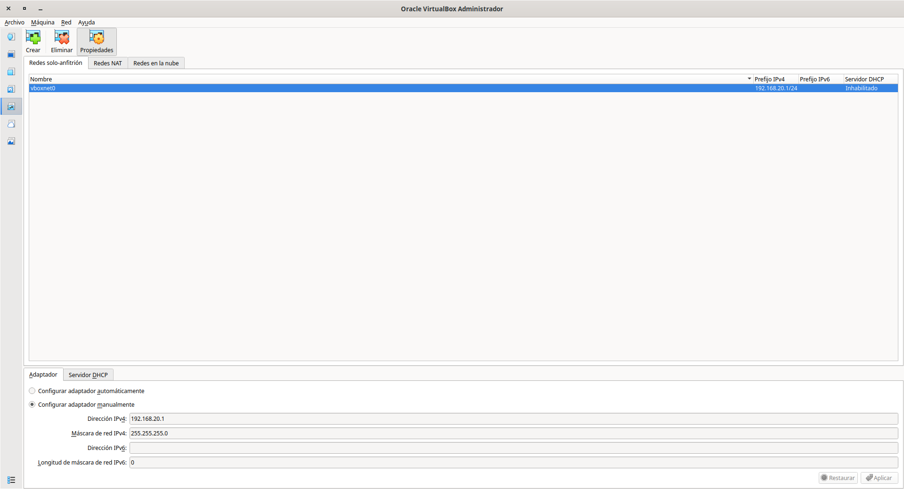

### 3. Creación de la VM
Antes de nada comprobé el SHA256 de la ISO de Proxmox VE 9.2 con el que pone en la web oficial, y es el mismo ([iso-sha256.txt](../evidencias/virtualbox/iso-sha256.txt)). Luego creé la VM `pve-pico` así:

| Opción | Valor | Por qué |
|---|---|---|
| Sistema | Debian (64-bit), con EFI | Proxmox 9 va sobre Debian 13 |
| CPU | 3 vCPU | Le dejo el resto de hilos a Debian |
| RAM | 4 GB | Primero le puse 6 GB, pero a Debian le quedaba muy poco |
| Disco | 70 GB VDI fijo, controlador virtio-scsi | Es un disco paravirtualizado y así no va creciendo |
| Adaptador 1 | Solo-anfitrión `vboxnet0`, virtio-net, promiscuo "Permitir todo" | Para entrar al panel y para la red de los invitados |
| Adaptador 2 | Red NAT `NatNetwork`, virtio-net | Para salir a Internet |
| VT-x anidado | Activado | Para tener KVM dentro de Proxmox |

La opción de VT-x anidado salía en gris y no se podía marcar. Buscando vi que se puede activar por terminal con `VBoxManage modifyvm "pve-pico" --nested-hw-virt on`, y así sí ([vbox-nested.txt](../evidencias/virtualbox/vbox-nested.txt)).

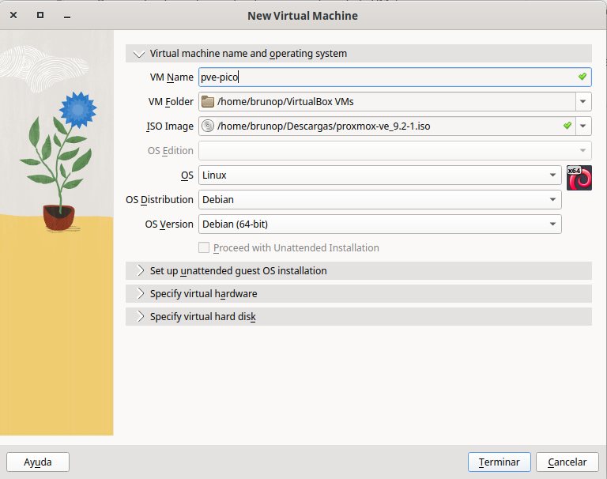
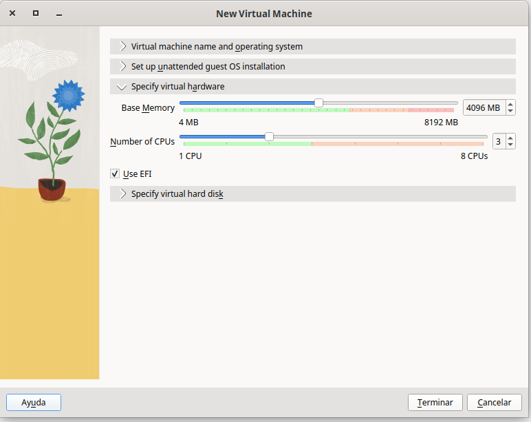
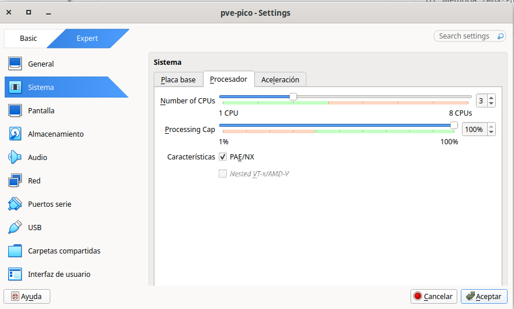
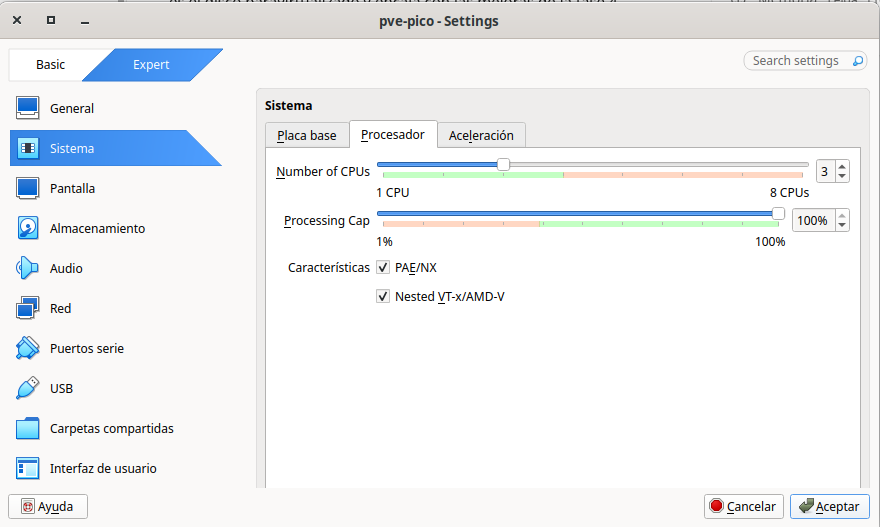
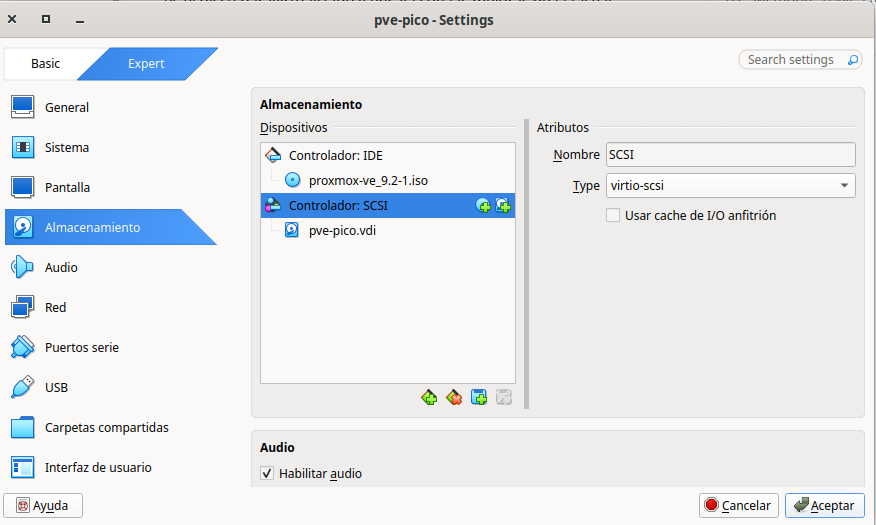
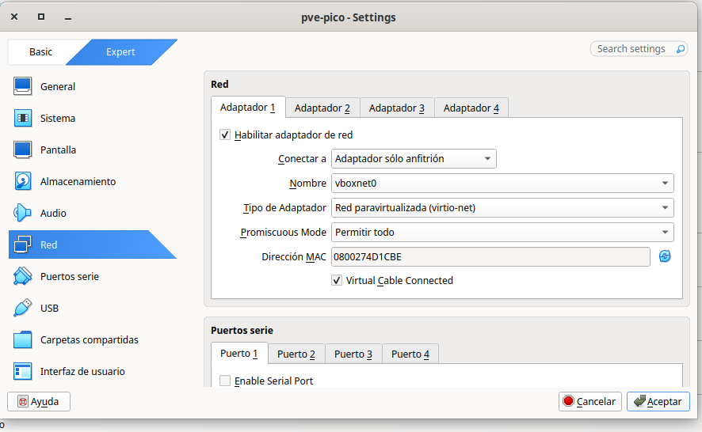
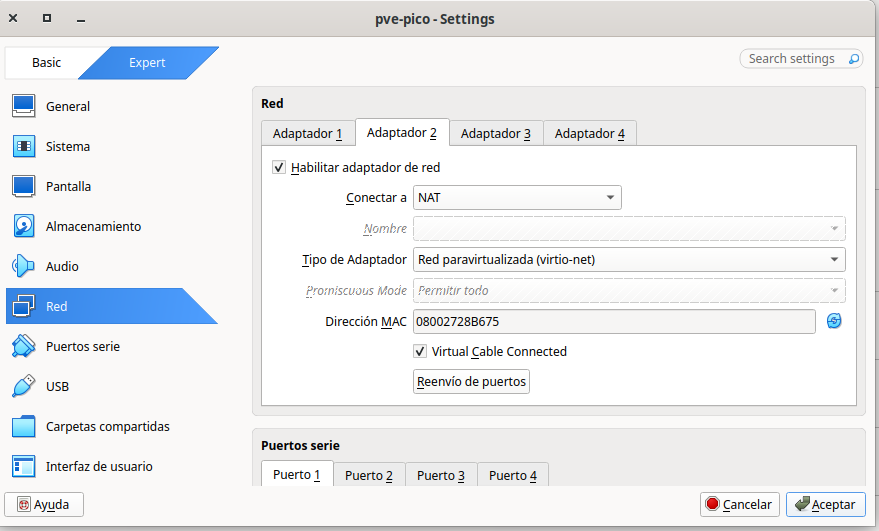
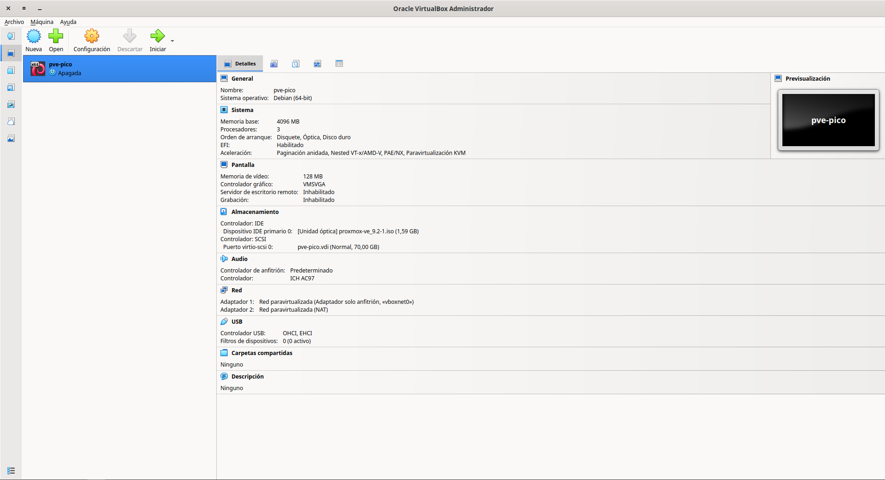

### 4. Instalación de Proxmox
En el instalador puse ext4 en `/dev/sda`, España, Europe/Madrid y teclado español. En la red, para no equivocarme de tarjeta, miré la MAC del adaptador 1 en VirtualBox (08:00:27:4d:1c:be) y elegí la `nic0`, que era la que tenía esa MAC. Hostname `pve-pico.local`, IP 192.168.20.10/24, gateway 192.168.20.1 (el instalador te obliga a poner uno, igual que en el Mac) y DNS 10.0.2.3, que luego cambié.

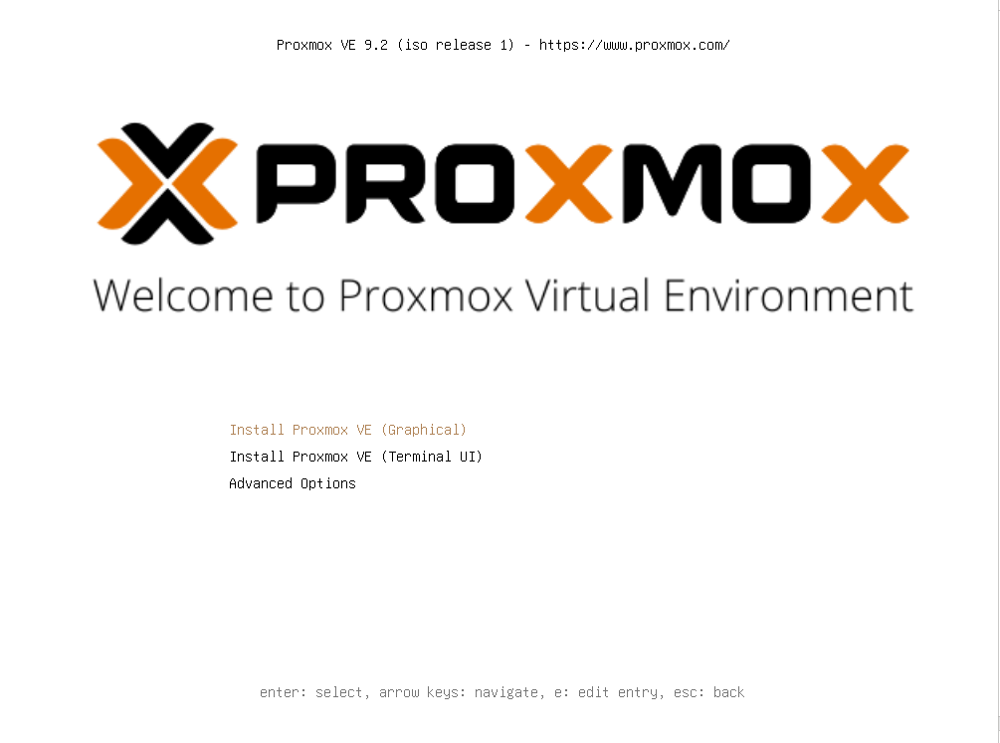
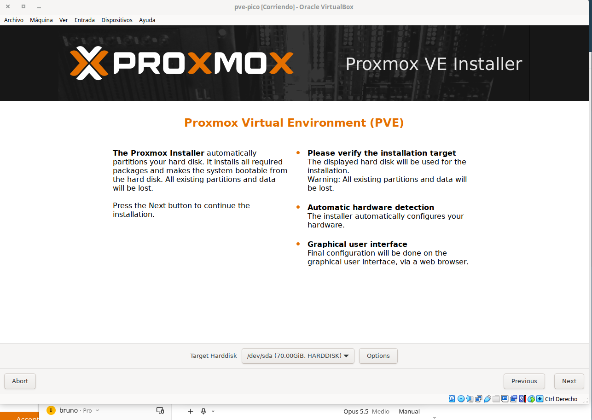
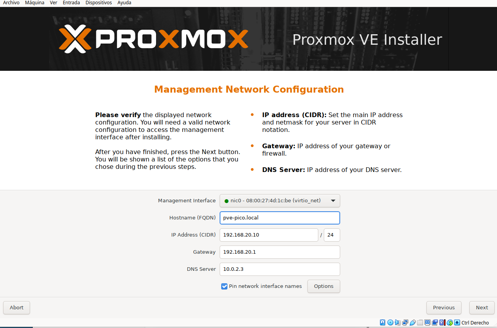
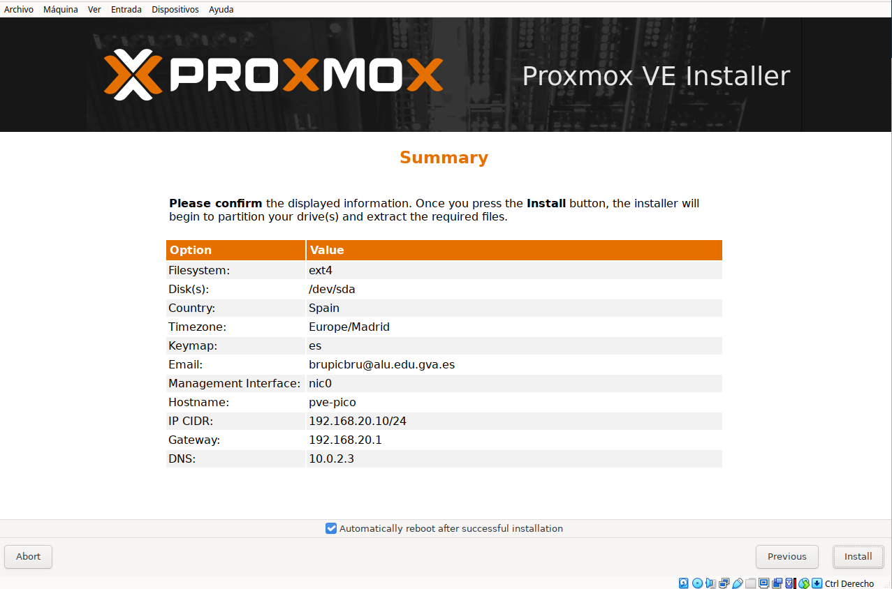
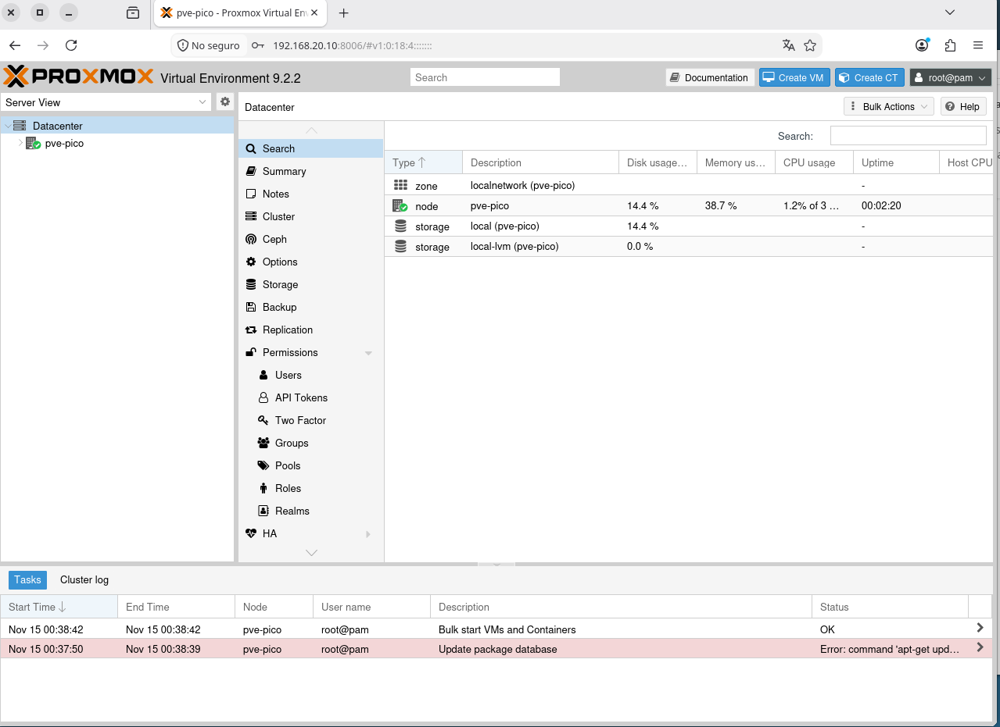

Después de instalar lo comprobé por SSH desde Debian ([pve-fase3.txt](../evidencias/virtualbox/pve-fase3.txt)): el hostname es `pve-pico`, la arquitectura x86-64, `pveversion` da 9.2.2 y el panel abre en `https://192.168.20.10:8006`. Lo que más me importaba era ver si ahora tenía KVM, y sí: `/dev/kvm` existe y la CPU tiene `vmx`. En el Mac esto no existía, así que ahora `srv-aso` podrá ser una VM de verdad. Además el disco con virtio-scsi arrancó a la primera, y en UTM con SCSI no había manera.

### 5. Red del nodo
Lo he hecho igual que en el Mac, pero ojo que aquí las tarjetas van al revés: `nic0` es la host-only y `nic1` la NAT ([pve-red-antes.txt](../evidencias/virtualbox/pve-red-antes.txt), [pve-red-despues.txt](../evidencias/virtualbox/pve-red-despues.txt)).

| Bridge | Tarjeta | IP | Gateway | Para qué |
|---|---|---|---|---|
| `vmbr0` | `nic0` (host-only) | 192.168.20.10/24 | No tiene | Panel, SSH y red de los invitados |
| `vmbr1` | `nic1` (Red NAT) | 10.0.2.100/24 | 10.0.2.1 | Salir a Internet |

Antes de tocar nada hice una copia de `/etc/network/interfaces`. Para que los invitados salgan a Internet puse una regla MASQUERADE hacia `vmbr1`. Me di cuenta de que cada vez que hacía `ifreload -a` la regla se volvía a añadir y salía repetida, así que la cambié para que primero mire si ya existe (`iptables -C ... || iptables -A ...`) y solo la añada si no está.

De DNS he dejado 10.0.2.1 y 1.1.1.1. El ping al gateway va bien y `deb.debian.org` se resuelve ([pve-conectividad.txt](../evidencias/virtualbox/pve-conectividad.txt)).

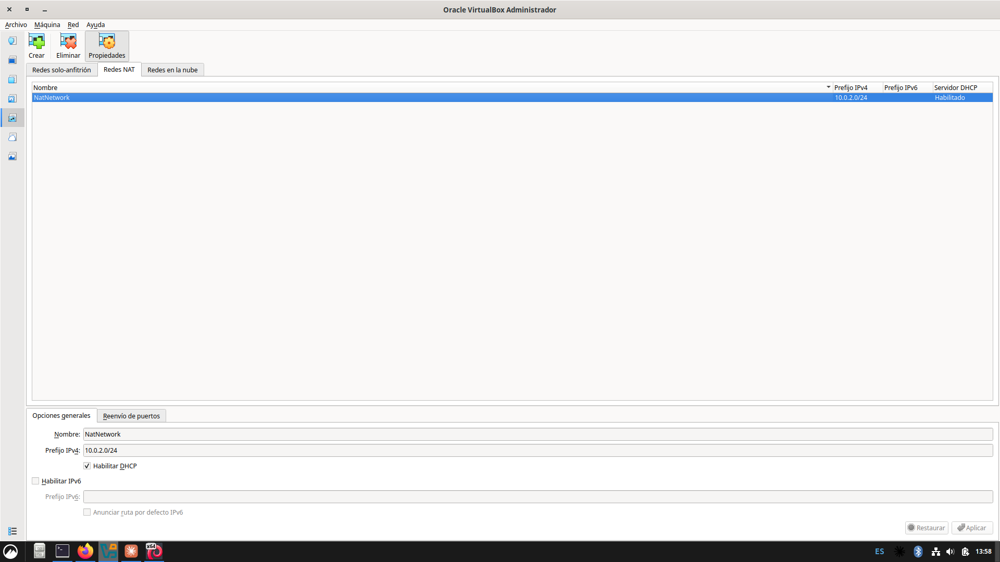
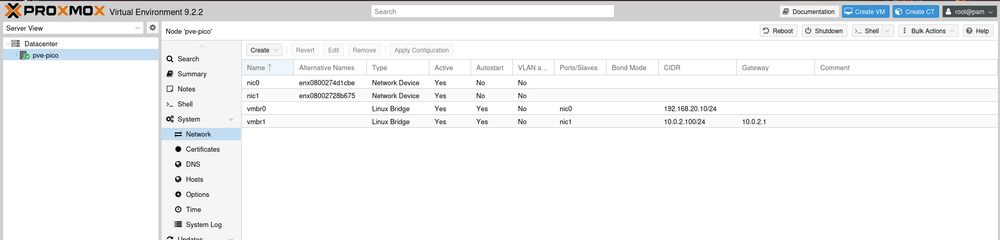

### 6. Repositorios y almacenamiento
Igual que me pasó en el Mac, los repositorios enterprise daban error 401 porque son de pago. Los desactivé y puse el No-Subscription, que es el gratuito. Ahora `apt update` va sin errores y me salen 213 paquetes para actualizar ([pve-apt-update.txt](../evidencias/virtualbox/pve-apt-update.txt)).

También he creado `backup-lab` en `/srv/backup-lab`, que solo sirve para guardar copias ([pve-almacenamiento.txt](../evidencias/virtualbox/pve-almacenamiento.txt)):

| Almacenamiento | Tipo | Qué admite | Total | Libre | Para qué lo uso |
|---|---|---|---|---|---|
| `local` | Directorio (`/var/lib/vz`) | Backup, Import, ISO y plantillas de contenedor | 27,8 GiB | 22,2 GiB | Plantillas LXC e ISOs |
| `local-lvm` | LVM-Thin | Discos de VM y contenedores | 26,5 GiB | 26,5 GiB | Discos de `srv-aso` y `cli-linux` |
| `backup-lab` | Directorio (`/srv/backup-lab`) | Solo backups | 27,8 GiB (el mismo que `local`) | 22,2 GiB | Copias de la fase 9 |

La swap es de 4 GB y en el grupo `pve` quedan 8,63 GB libres. En `local-lvm` solo se pueden guardar discos, por eso las copias van a `backup-lab`.

El problema que veo es que `backup-lab` está dentro del disco de la VM (`pve-pico-fijo.vdi`), y ese archivo está en el mismo NVMe que Debian, que tiene 868 GB libres ([host-df.txt](../evidencias/virtualbox/host-df.txt)). O sea, si se rompe el NVMe o se estropea el VDI, pierdo el laboratorio y las copias de golpe. En la fase 9 sacaré una copia fuera de la VM.

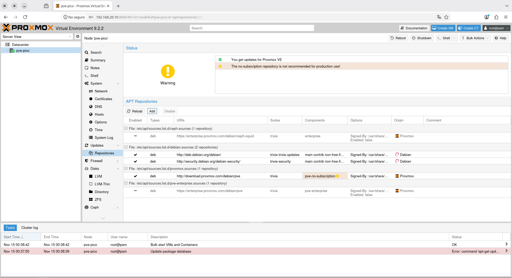
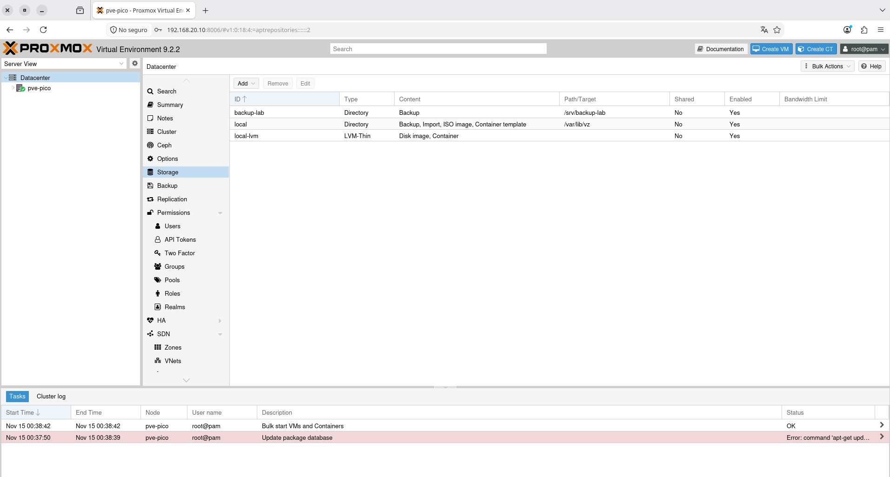

### 7. Mejoras de la VM
En el Mac solo pude hacer tres de las cinco mejoras que pidió el profesor. Aquí con VirtualBox las he podido hacer todas ([pve-mejoras.txt](../evidencias/virtualbox/pve-mejoras.txt), [vbox-vminfo.txt](../evidencias/virtualbox/vbox-vminfo.txt), [vbox-disco-fijo.txt](../evidencias/virtualbox/vbox-disco-fijo.txt)):

| Mejora | ¿Hecha? | Cómo lo compruebo |
|---|---|---|
| VT-x anidado | Sí | `Nested VT-x/AMD-V: enabled` y existe `/dev/kvm` en el nodo |
| Paravirtualización KVM | Sí | `Effective Paravirt. Prov.: KVM` y driver `virtio_net` |
| Modo promiscuo | Sí | `Promisc Policy: allow-all` y `promiscuity 1` en `nic0` |
| Disco de tamaño fijo | Sí | `Format variant: fixed default` |
| Controlador virtio-scsi | Sí | `Type: VirtioSCSI` y driver `virtio_scsi` |

### 8. Accesos y recursos

| Cuenta | Realm | Permisos | Para qué la uso |
|---|---|---|---|
| `root` | Linux PAM | Administrador de todo | Es la única: panel, consola y SSH |

Como el laboratorio solo lo uso yo, con `root@pam` me vale. Si fuera una empresa crearía otro usuario con el rol `PVEVMAdmin`, que puede manejar las máquinas pero no tocar el nodo. Para no tener que poner la contraseña en cada comando copié mi clave pública al nodo con `ssh-copy-id`. Las contraseñas y las claves no salen en ninguna captura ni en el repositorio.

El firewall de Proxmox lo dejo desactivado y sin reglas porque no es obligatorio. Aun así el laboratorio está bastante aislado:
- Al panel y al SSH solo se puede entrar por `vboxnet0`, que es una red host-only que solo existe entre mi portátil y la VM.
- Los invitados solo salen a Internet pasando por el nodo, con NAT.
- La Red NAT de VirtualBox también hace NAT, así que desde fuera nadie puede entrar a la VM.

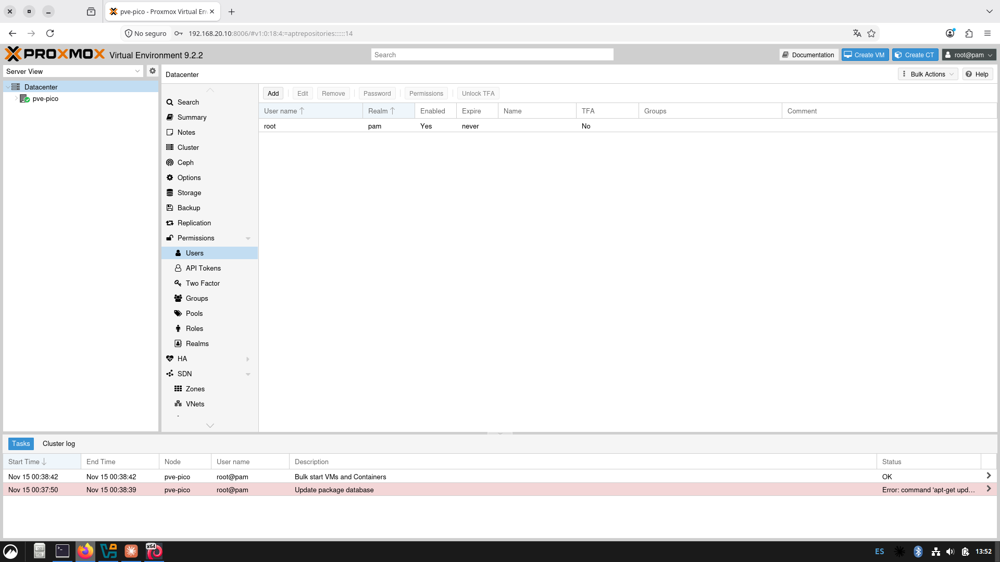
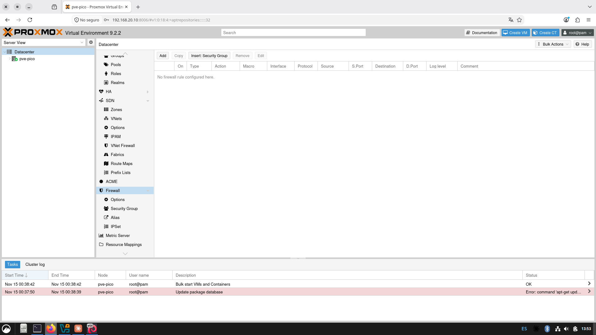

| Elemento | CPU/vCPU | RAM | Disco | Por qué |
|---|---|---|---|---|
| Debian (anfitrión) | 5 hilos de 8 | 3,6 GiB | NVMe, 868 GB libres | Para que el portátil no vaya lento con la VM encendida |
| VM `pve-pico` (VirtualBox) | 3 vCPU | 4 GB | 70 GB fijos | Dentro va todo el laboratorio |
| Nodo Proxmox | Comparte las 3 vCPU | 1,5 GB | Raíz de 28,4 GB y swap de 4 GB | Sistema y panel (en [pve-mejoras.txt](../evidencias/virtualbox/pve-mejoras.txt) se ve que usa 1,5 GiB) |
| `srv-aso` (VM) | 1 vCPU | 1 GB | 10 GB en `local-lvm` | El servicio principal. Al ser VM gasta más que un LXC |
| `cli-linux` (LXC) | 1 vCPU | 512 MB | 8 GB en `local-lvm` | Solo lo uso para probar el servicio |
| Plantillas, ISOs, copias y margen | — | 1 GB de margen | 8,5 GB en `local-lvm` y 22,2 GB en la raíz | Para poder clonar y hacer copias sin quedarme sin sitio |

- RAM: 4 GB − 1,5 del nodo − 1 de `srv-aso` − 0,5 de `cli-linux` = 1 GB que me sobra, y si hace falta el nodo tiene 4 GB de swap.
- Disco: en `local-lvm` me quedan 26,5 − 10 − 8 = 8,5 GB para clones, y en la raíz 22,2 GB para plantillas, ISOs y copias.
- CPU: las 3 vCPU se las reparten el nodo y los dos invitados. Como no van a hacer mucho, van bien los tres a la vez.

No le doy a la VM todo lo que tiene el portátil, le dejo 3,6 GiB y 5 hilos a Debian para poder seguir usándolo.

## Comandos usados

```bash
# En Debian (anfitrión)
sha256sum proxmox-ve_9.2-1.iso
VBoxManage modifyvm "pve-pico" --nested-hw-virt on
VBoxManage clonemedium disk pve-pico.vdi pve-pico-fijo.vdi --format VDI --variant Fixed
VBoxManage storageattach pve-pico --storagectl SCSI --port 0 --device 0 --type hdd --medium pve-pico-fijo.vdi
VBoxManage showvminfo pve-pico
VBoxManage showmediuminfo pve-pico-fijo.vdi
ssh-copy-id root@192.168.20.10

# En el nodo
hostnamectl; ip -br addr; ip route; pveversion; ls -l /dev/kvm
cp /etc/network/interfaces /root/interfaces.bak
ifreload -a
iptables -t nat -L POSTROUTING -n -v
ping -c3 10.0.2.1; getent ahostsv4 deb.debian.org; apt update
mkdir -p /srv/backup-lab
pvesm add dir backup-lab --path /srv/backup-lab --content backup
pvesm status; df -h /; lvs; vgs
ls /sys/bus/virtio/drivers; lsblk; ip -d link show nic0; free -h
```

## Evidencias

- [host-*.txt](../evidencias/virtualbox/host-lscpu.txt): datos del portátil (CPU con VT-x, 7,6 GiB, NVMe, Debian 13.7 y Secure Boot activado).
- [iso-sha256.txt](../evidencias/virtualbox/iso-sha256.txt): el SHA256 de la ISO es el mismo que el de la web de Proxmox.
- [vbox-nested.txt](../evidencias/virtualbox/vbox-nested.txt): VT-x anidado activado.
- [pve-fase3.txt](../evidencias/virtualbox/pve-fase3.txt): hostname `pve-pico`, Proxmox 9.2.2 y `/dev/kvm`.
- [pve-red-antes.txt](../evidencias/virtualbox/pve-red-antes.txt): la red como la dejó el instalador, solo `vmbr0` con el gateway falso y `nic1` apagada.
- [pve-red-despues.txt](../evidencias/virtualbox/pve-red-despues.txt): `vmbr0` y `vmbr1` levantados, ruta por 10.0.2.1 y una sola regla NAT. Me falta probar el NAT desde los invitados en la fase 5.
- [pve-conectividad.txt](../evidencias/virtualbox/pve-conectividad.txt): ping al gateway, DNS y el primer `apt update` con el error 401.
- [nat-simple-error.txt](../evidencias/virtualbox/nat-simple-error.txt): el error del NAT simple de VirtualBox.
- [pve-apt-update.txt](../evidencias/virtualbox/pve-apt-update.txt): `apt update` ya sin errores. Me quedan 213 paquetes por actualizar.
- [pve-almacenamiento.txt](../evidencias/virtualbox/pve-almacenamiento.txt): `local`, `local-lvm` y `backup-lab` activos y cómo está repartido el disco.
- [pve-mejoras.txt](../evidencias/virtualbox/pve-mejoras.txt): drivers virtio, `promiscuity 1` en `nic0` y 3,8 GiB de RAM en el nodo.
- [vbox-vminfo.txt](../evidencias/virtualbox/vbox-vminfo.txt): VT-x anidado, KVM, virtio-scsi y las dos tarjetas virtio en modo promiscuo.
- [vbox-disco-fijo.txt](../evidencias/virtualbox/vbox-disco-fijo.txt): disco fijo de 70 GB.
- Capturas: creación de la VM, instalador, panel, Network, Storage, repositorios, usuarios y firewall (están arriba).

## Incidencias
- Con Secure Boot no cargaban los módulos de VirtualBox. Lo arreglé firmándolos con una clave MOK.
- La casilla de VT-x anidado salía en gris. La activé con `VBoxManage`.
- Le puse 6 GB de RAM a la VM y luego la bajé a 4 GB, porque el portátil solo tiene 7,6 GiB y Debian iba muy justo.
- En el instalador escribí `pve.pico.local` en vez de `pve-pico.local` y el hostname se quedaba en `pve`. Me di cuenta en el resumen y lo cambié antes de darle a instalar.
- Puse los adaptadores al revés (la NAT en el 1) y el host-only se me quedó como "Red interna". Lo vi en el resumen de la VM y lo arreglé antes de arrancarla.
- Con el modo "NAT" normal de VirtualBox el gateway 10.0.2.2 no contestaba ni al ARP (`10.0.2.2 FAILED`). Probé también con la IP 10.0.2.15, que es la que da su DHCP, y tampoco. Al final lo cambié a "Red NAT" (`NatNetwork`), que funciona como un router de verdad y deja poner IPs fijas ([nat-simple-error.txt](../evidencias/virtualbox/nat-simple-error.txt)). Así el gateway pasó a ser 10.0.2.1, como tenía en el diseño.
- La regla MASQUERADE salía repetida después de hacer varios `ifreload -a`. Ahora solo se añade si no existe.
- Aunque marqué "Reservar completamente", el disco se creó dinámico. Con la VM apagada lo pasé a fijo con `VBoxManage clonemedium ... --variant Fixed` y le puse el disco nuevo.
- Los repositorios enterprise daban error 401 y los cambié por el No-Subscription.

## Conclusion
Tengo el nodo igual que en el Mac pero ahora con KVM, que era lo que me faltaba. Así en la fase 5 `srv-aso` podrá ser una VM. Me queda actualizar los 213 paquetes, bajar las plantillas y comprobar que los invitados salen a Internet por el NAT.

[Volver al indice](../README.md)
