# 03-instalacion-proxmox

## Objetivo
En esta fase instalo Proxmox VE 9.2 para ARM64 en una VM de UTM, siguiendo el diseño de red del [02](02-diagrama-red.md). Al terminar quiero poder entrar al panel web desde el navegador de mi Mac.

## Procedimiento

### 1. Equipo anfitrión y UTM
Uso un MacBook Air con chip M4, 16 GB de RAM y macOS 27.0.1. Para virtualizar uso UTM versión 4.7.5, con el motor QEMU. No uso VirtualBox porque en Mac con chip Apple funciona peor que UTM.

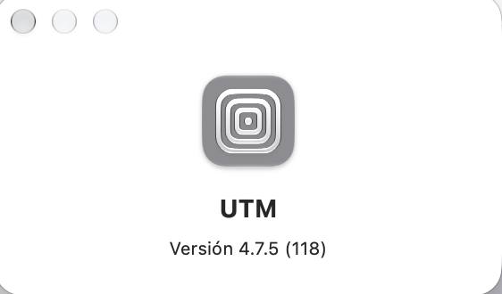

### 2. Creación de la VM
He creado una VM Linux ARM64 con los recursos del diseño:

| Recurso | Valor |
|---|---|
| Motor | QEMU (virtualización) |
| CPU | 2 vCPU |
| RAM | 6 GB |
| Disco | 70 GB |
| Rosetta | Desactivado |

Al Mac le quedan 10 GB de RAM para macOS, así no se queda sin memoria mientras la VM está encendida.

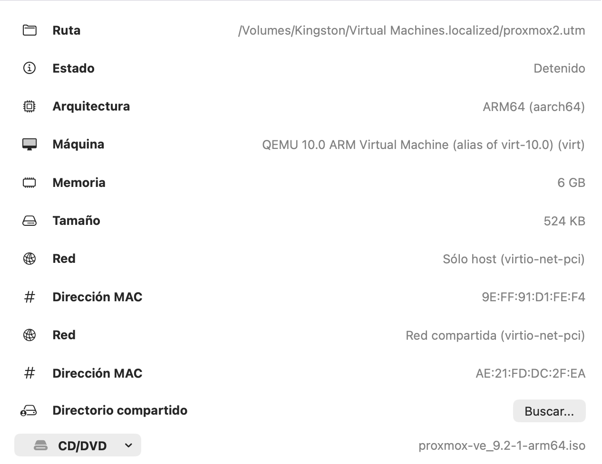

### 3. Red de la VM
La VM tiene dos tarjetas de red, como en el diseño:

- Tarjeta 1: red host-only 192.168.20.0/24. Es la red de gestión y la de las máquinas invitadas.
- Tarjeta 2: red compartida (NAT de UTM) 10.0.2.0/24. Es la salida a Internet.

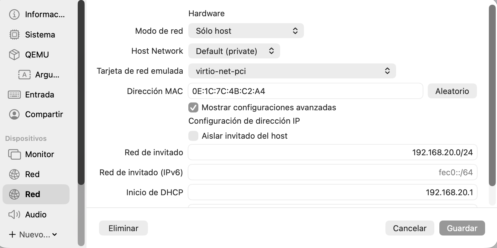


### 4. Virtualización anidada
Con el motor QEMU de UTM en un Mac con chip Apple no hay virtualización anidada. Lo he comprobado después de instalar: `ls -l /dev/kvm` dice que no existe y en `dmesg` sale `kvm [1]: HYP mode not available`, es decir, la VM no tiene el modo hipervisor de la CPU. Al intentar arrancar una VM de prueba en Proxmox da error de KVM.

Por eso `srv-aso` y `cli-linux` serán contenedores LXC, que no necesitan KVM. Las VMs sin KVM irían emuladas y muy lentas.

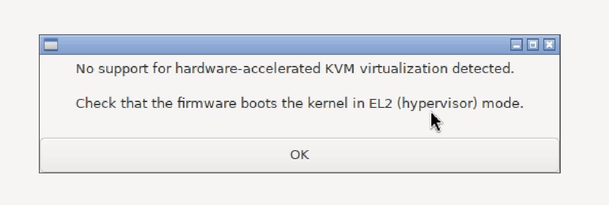

### 5. Instalación de Proxmox
He usado la ISO de Proxmox VE 9.2 para ARM64 (`proxmox-ve_9.2-1-arm64.iso`), descargada de la página oficial de Proxmox.

En el instalador he elegido:
- Disco: el disco de 70 GB de la VM (`/dev/vda`).
- Sistema de archivos: ext4 (LVM), porque ZFS gasta más RAM y solo tengo 6 GB en la VM.
- País, zona horaria y teclado: España, Europe/Madrid, español.

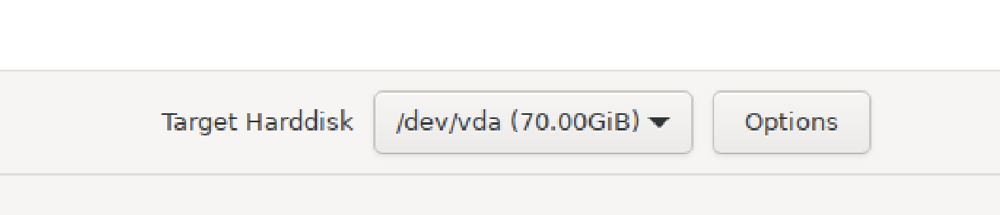
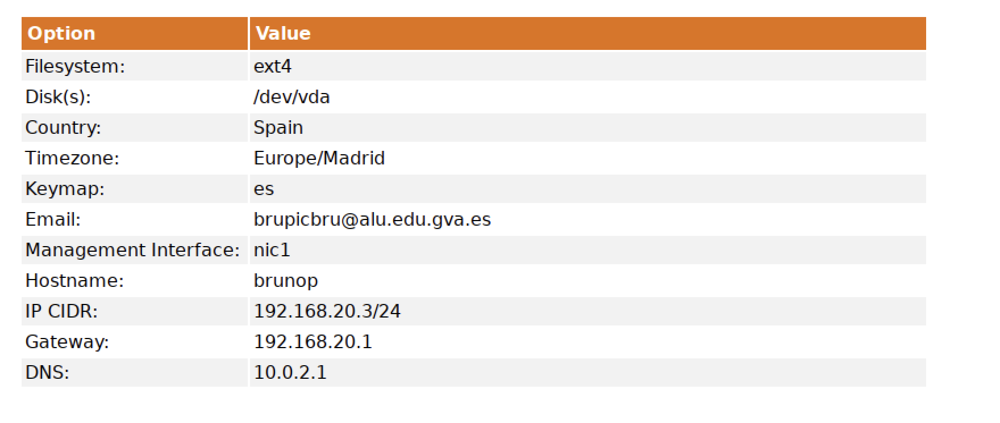

### 6. Hostname, IP, gateway y DNS
En la pantalla de red del instalador he elegido la tarjeta de la red host-only como interfaz de gestión:

| Dato | Valor |
|---|---|
| Hostname | brunop.local |
| Interfaz de gestión | nic1 (tarjeta host-only) |
| IP de gestión | 192.168.20.3/24 |
| Gateway (en el instalador) | 192.168.20.1 |
| DNS | 10.0.2.1 |

El instalador obliga a poner un gateway, pero la red host-only no tiene salida a Internet. Puse 192.168.20.1 (el Mac en la red host-only) solo para poder seguir. El gateway real, por la red compartida, lo configuraré en la fase de red.

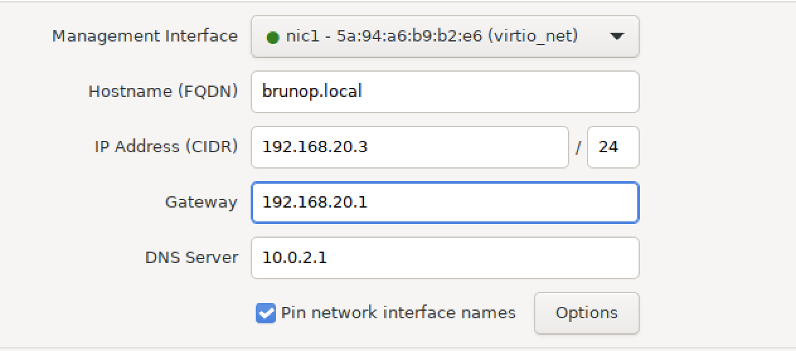

### 7. Acceso al panel web
Desde el navegador del Mac entro a `https://192.168.20.3:8006`. Sale un aviso de certificado porque es autofirmado, lo acepto y entro con el usuario `root` (Linux PAM).

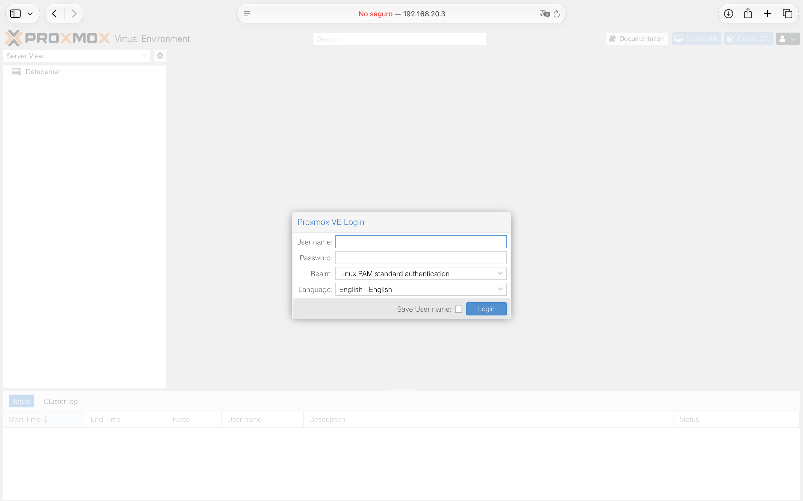

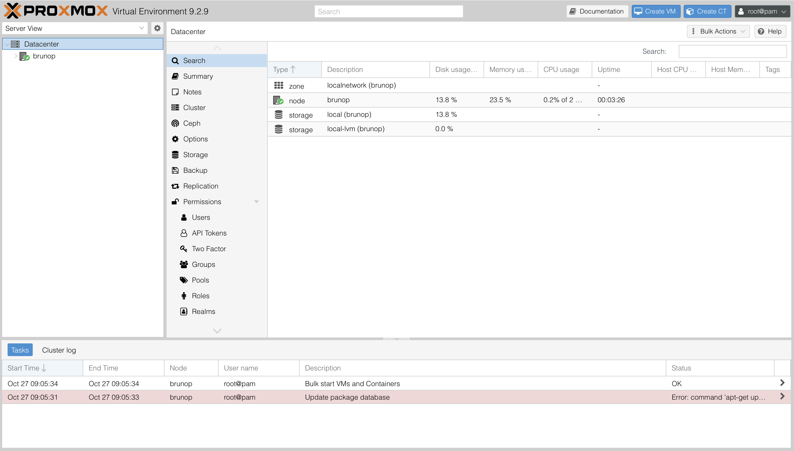

### 8. Red y almacenamiento después de instalar
`pveversion` muestra `pve-manager/9.2.9` con el kernel `7.0.14-6-pve`, y `hostnamectl` confirma que es Debian 13 (trixie) en arm64 dentro de QEMU.

El instalador crea el bridge `vmbr0` con la tarjeta host-only y la IP 192.168.20.3. La otra tarjeta (`nic0`, red compartida) queda sin configurar. El resto de la red (bridges del diseño y NAT) lo configuro en la fase siguiente.

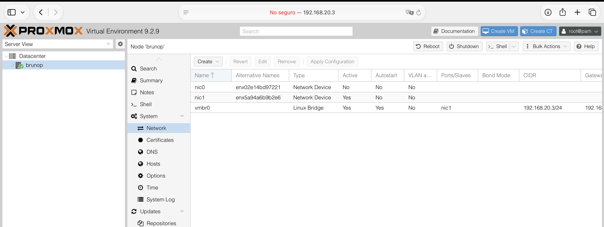

Con ext4 el instalador crea dos almacenamientos. La raíz (`/dev/mapper/pve-root`) tiene 28 GB con 3,7 GB usados y el resto del disco queda para `local-lvm`:
- `local`: guarda ISOs, plantillas de contenedores y copias de seguridad.
- `local-lvm`: guarda los discos de las VMs y de los contenedores.


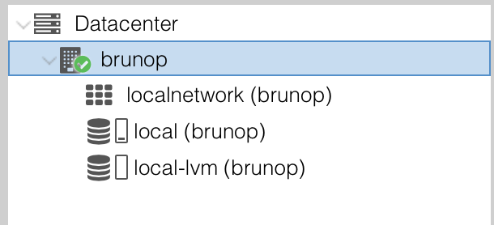
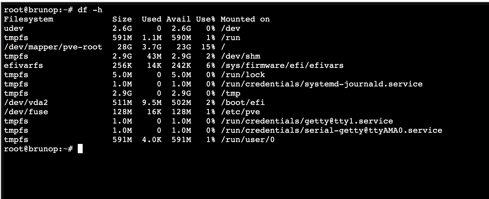

### 9. srv-aso y cli-linux
Las dos máquinas irán dentro de Proxmox, no como VMs de UTM. Como no hay virtualización anidada, serán contenedores LXC sin privilegios. Los crearé en la fase 5.

## Comandos usados

```bash
# Evidencias que pide el enunciado
hostnamectl
ip -br addr
pveversion
df -h

# Virtualización anidada
ls -l /dev/kvm
dmesg | grep -i -E "kvm|hyp|EL2"
```

## Evidencias

- [Panel de Proxmox](../evidencias/capturas-o-salidas/proxmox_navegador.png): entro al panel desde el navegador del Mac.
- [Red en Proxmox](../evidencias/capturas-o-salidas/red_proxmox.png): `vmbr0` creado por el instalador con la IP 192.168.20.3.
- [Almacenamiento en Proxmox](../evidencias/capturas-o-salidas/almacenamiento_proxmox.png): `local` y `local-lvm`.
- [hostnamectl](../evidencias/capturas-o-salidas/hostnamectl.txt): nombre del nodo (brunop), Debian 13, arm64 y virtualización QEMU.
- [ip -br addr](../evidencias/capturas-o-salidas/ipbr-pve.txt): `vmbr0` con la IP 192.168.20.3, `nic1` UP y `nic0` DOWN.
- [pveversion](../evidencias/capturas-o-salidas/pveversion.txt): pve-manager 9.2.9 con kernel 7.0.14-6-pve.
- [df -h](../evidencias/capturas-o-salidas/df-pve.txt): raíz de 28 GB con 3,7 GB usados.
- [Virtualización anidada](../evidencias/capturas-o-salidas/kvm.txt): no hay `/dev/kvm` y `HYP mode not available`.
- Capturas de UTM e instalador: en los apartados 1, 2, 3, 5 y 6.

## Incidencias

- En el instalador puse el hostname `brunop.local` en lugar de `pve-pico`, que es el nombre del diseño. Más adelante lo cambiaré por `pve-pico`.
- Probé el motor Apple Virtualization de UTM para tener virtualización anidada, pero no tiene red host-only y el diseño necesita dos tarjetas. Me quedé con QEMU y los invitados serán LXC.
- El instalador pide un gateway en la interfaz de gestión y la red host-only no tiene salida a Internet. Puse 192.168.20.1 para poder seguir y el gateway real lo configuraré en la fase de red.

## Conclusion
Proxmox queda instalado en una VM de UTM y accesible desde el Mac en `https://192.168.20.3:8006`. Como no hay virtualización anidada, `srv-aso` y `cli-linux` serán contenedores LXC. En la fase siguiente configuraré la red como en el diseño.

[Volver al indice](../README.md)